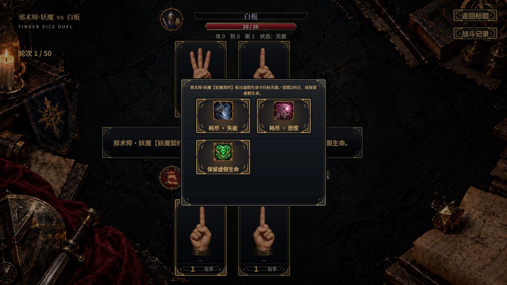
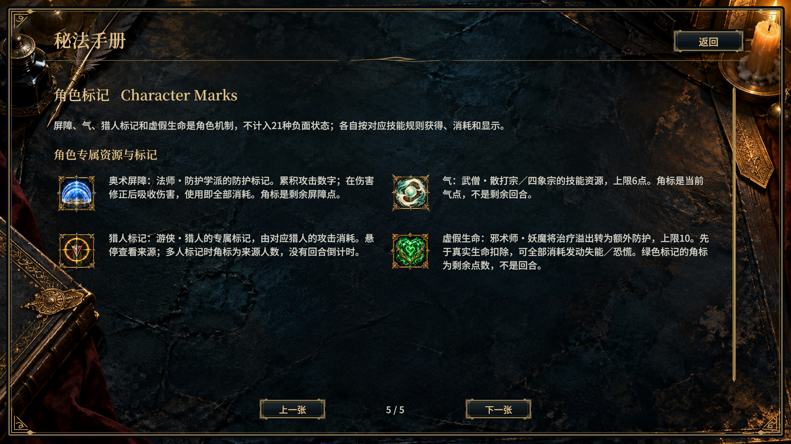
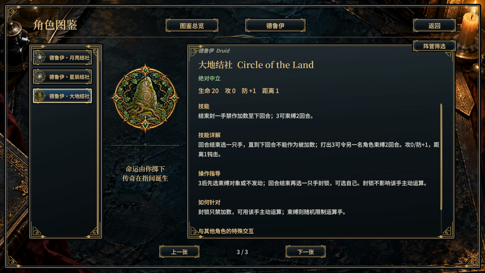
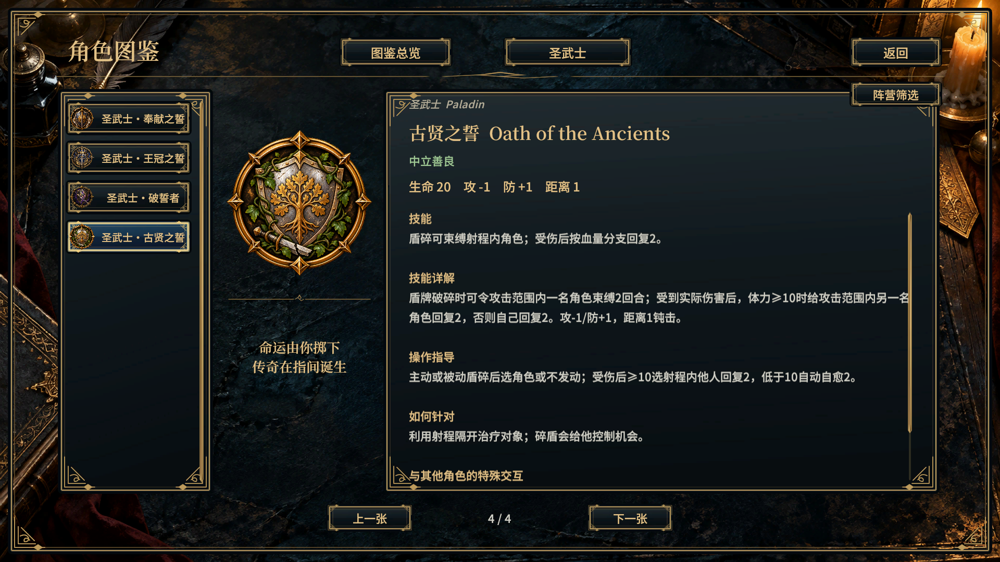
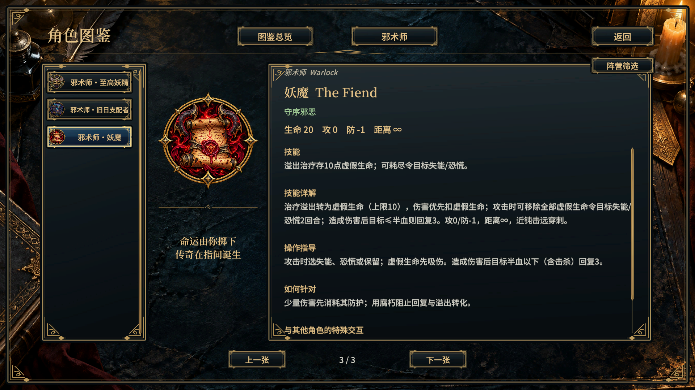
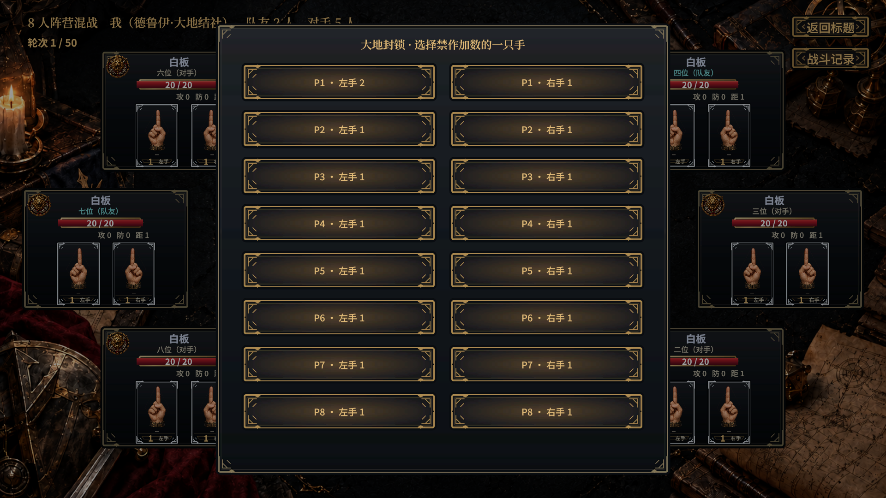
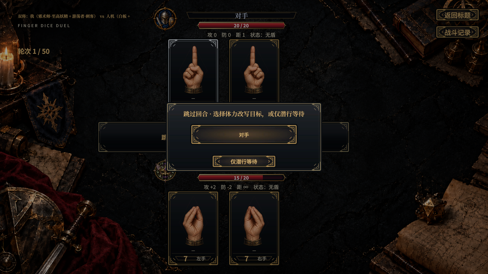
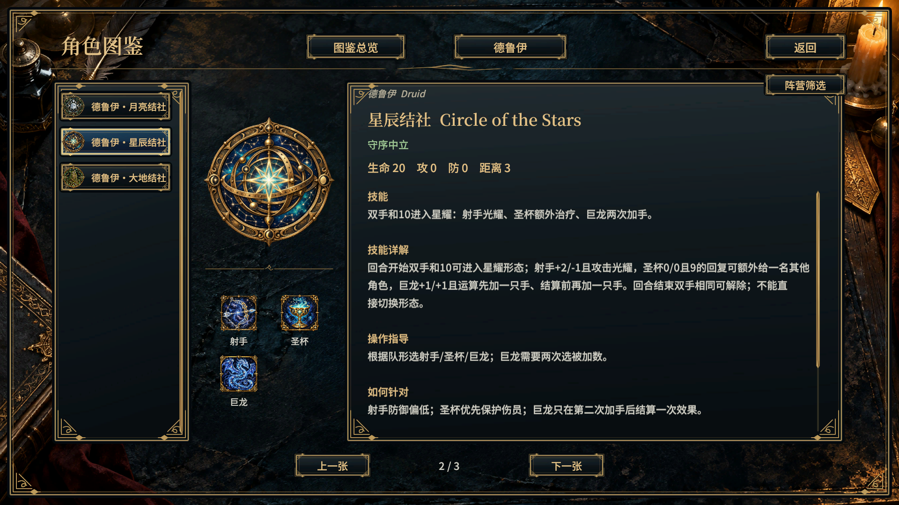

# 新三子职与绿色虚假生命验收

团结引擎2022.3.62t15中运行，[验收脚本](review.cs.txt)配合[点击与渲染助手](helpers.cs.txt)，[109项新角色检查](validation.txt)与[21项阵营／双将检查](validation-alignment.txt)通过，共130项。点击均经EventSystem射线与真实Button事件，截图1920×1080；没有写入玩家通关或设置。

- 22项角色/选择测试在引擎中再次执行；45名选将列表中三枚新徽记均可滚动定位、点击并加载。
- 图鉴职业筛选为德鲁伊3、圣武士4、邪术师3；三行中英文／阵营与技能说明正常，滚动内容可容纳，无人为断开数字。
- 大地3先选角色或不发动，再强制选封锁手；主动运算仍可用。4人8选项、8人16选项的最后一项均可点击。
- 古贤主动破盾选束缚、受伤后选治疗目标；妖魔失能／恐慌／保留实际按钮与资源消耗、附状态流程正常。
- 秘法手册角色标记页4枚图标加载且文字可容纳；绿色虚假生命7点挡5伤后剩2、实际生命保持20。

## 截图

其他原始截图同目录；[美术来源与完整提示词](../../Production/ancient-roles-v1/README.md)。[全量无头1286项通过](headless-full.txt)、[Unity条件编译](unity-compile.txt)与[UI编译](ui-compile.txt)均通过。

## 至高妖精与星辰阵营

[复现脚本](review-alignment.cs.txt)实际验证混乱中立的妖精、守序中立的星辰图鉴；副将列表分别12与13名，旧跨阵营伙伴被排除。妖精＋刺客跳过后，点击目标执行体力改写，点击“仅潜行等待”保留对手生命；均只推进一次回合。

同日后续新增3角色后，上述109＋21项已在45角色版本再次通过；完整最新回归见[新三角色验收](../lore-storm-illusion/README.md)。本目录1286日志保留新增后一批角色之前的通过记录。
