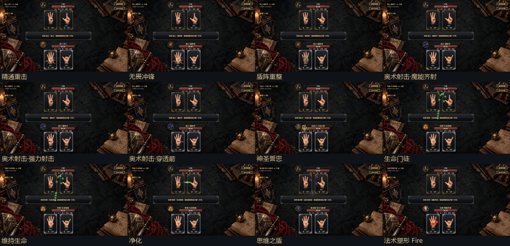
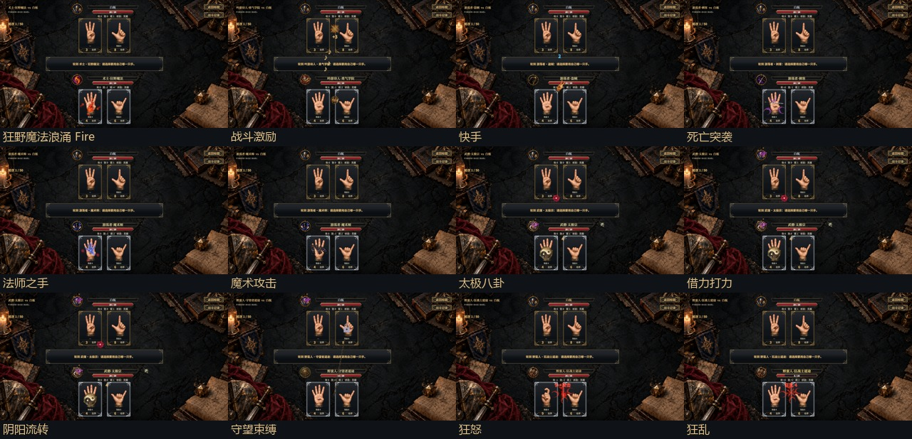
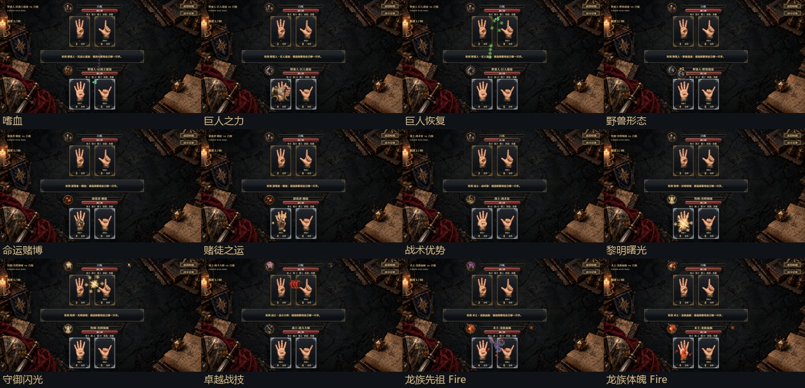
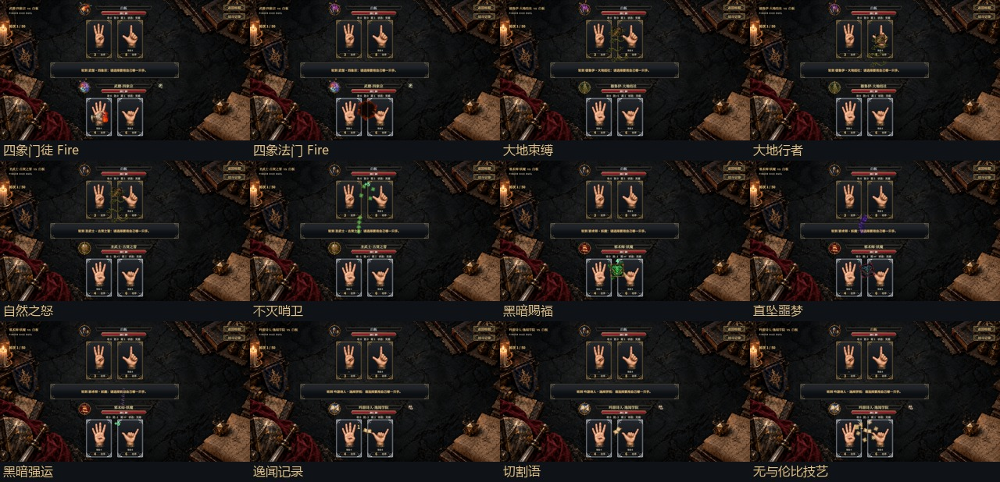
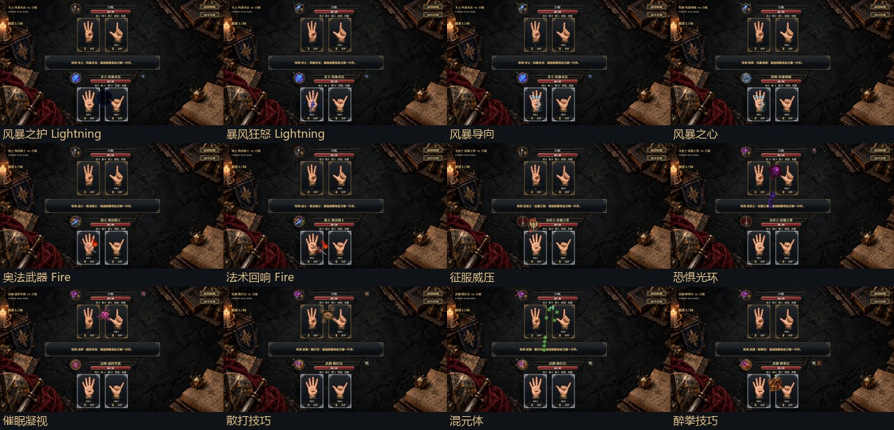
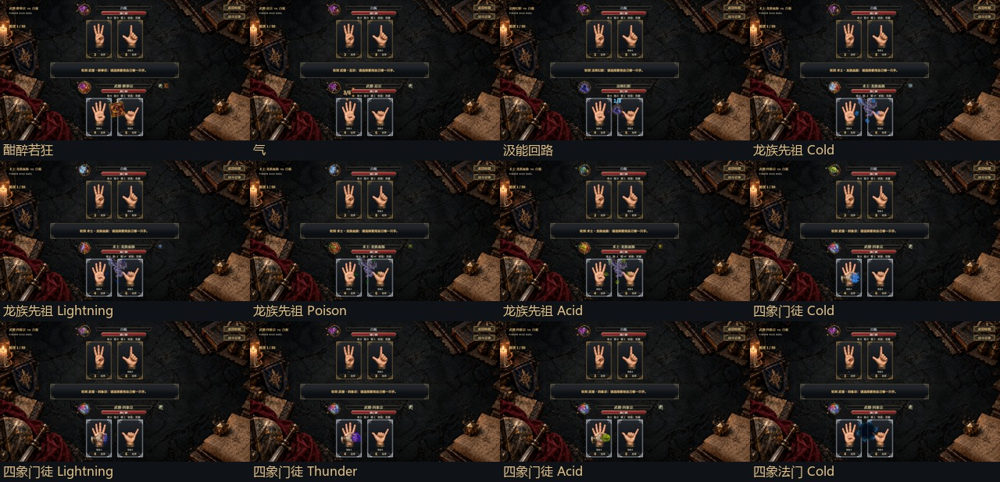
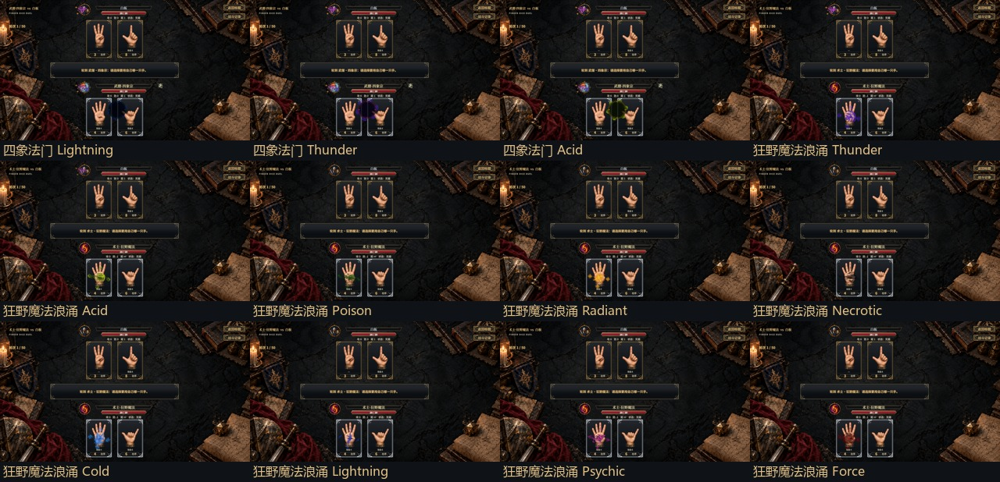
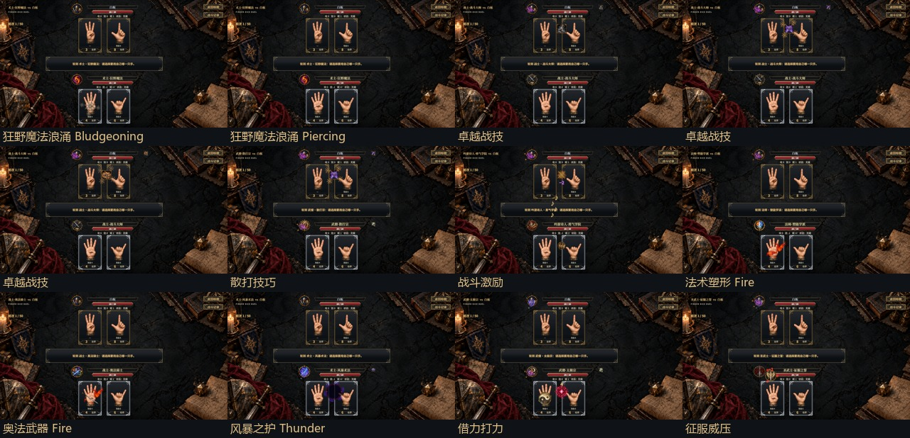
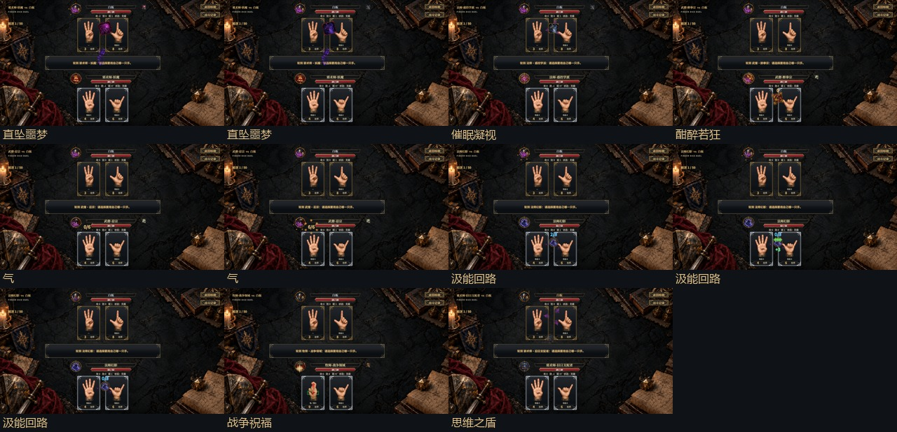

# P2／P3动画定稿与截图

**64个语义入口、33类动作、107种定稿变体，214张1280×720关键帧。** 每项保存起势0.28与高峰0.62；这是表现变体数量，不是角色数量。

截图由Unity原生Canvas与生产播放器的同一个绘制方法输出。WebP采用无损编码，导出逐像素核对与Unity原PNG一致；未后期绘画。总览仅缩放拼接原图。受控姿态样例用于审美、落点和缺图检查，不能混称为一次真实技能操作测试。

## 总览

## 每项最终稿

| 片段 | 技能／主要变体 | 起势 | 高峰 |
|---|---|---|---|
| p3-01-strike | 精通重击 · critical | [截图](p3-01-strike/windup.webp) | [截图](p3-01-strike/peak.webp) |
| p2-02-strike | 无畏冲锋 · charge | [截图](p2-02-strike/windup.webp) | [截图](p2-02-strike/peak.webp) |
| p2-03-repair | 盾阵重整 | [截图](p2-03-repair/windup.webp) | [截图](p2-03-repair/peak.webp) |
| p2-04-arrows | 奥术射击·魔能齐射 · volley | [截图](p2-04-arrows/windup.webp) | [截图](p2-04-arrows/peak.webp) |
| p2-05-arrows | 奥术射击·强力射击 · power | [截图](p2-05-arrows/windup.webp) | [截图](p2-05-arrows/peak.webp) |
| p2-06-arrows | 奥术射击·穿透箭 · piercing | [截图](p2-06-arrows/windup.webp) | [截图](p2-06-arrows/peak.webp) |
| p3-07-growth | 神圣誓忠 · crown | [截图](p3-07-growth/windup.webp) | [截图](p3-07-growth/peak.webp) |
| p2-08-heal | 生命门徒 | [截图](p2-08-heal/windup.webp) | [截图](p2-08-heal/peak.webp) |
| p2-09-heal | 维持生命 | [截图](p2-09-heal/windup.webp) | [截图](p2-09-heal/peak.webp) |
| p2-10-cleanse | 净化 | [截图](p2-10-cleanse/windup.webp) | [截图](p2-10-cleanse/peak.webp) |
| p2-11-eye | 思维之盾 | [截图](p2-11-eye/windup.webp) | [截图](p2-11-eye/peak.webp) |
| p2-12-enchant | 法术塑形 · Fire · prepare | [截图](p2-12-enchant/windup.webp) | [截图](p2-12-enchant/peak.webp) |
| p2-13-surge | 狂野魔法浪涌 · Fire | [截图](p2-13-surge/windup.webp) | [截图](p2-13-surge/peak.webp) |
| p2-14-music | 战斗激励 · BoostAttack | [截图](p2-14-music/windup.webp) | [截图](p2-14-music/peak.webp) |
| p2-15-steal | 快手 | [截图](p2-15-steal/windup.webp) | [截图](p2-15-steal/peak.webp) |
| p2-16-strike | 死亡突袭 · shadow | [截图](p2-16-strike/windup.webp) | [截图](p2-16-strike/peak.webp) |
| p2-17-hand | 法师之手 | [截图](p2-17-hand/windup.webp) | [截图](p2-17-hand/peak.webp) |
| p2-18-cards | 魔术攻击 | [截图](p2-18-cards/windup.webp) | [截图](p2-18-cards/peak.webp) |
| p2-19-taichiboost | 太极八卦 | [截图](p2-19-taichiboost/windup.webp) | [截图](p2-19-taichiboost/peak.webp) |
| p2-20-taichiboost | 借力打力 | [截图](p2-20-taichiboost/windup.webp) | [截图](p2-20-taichiboost/peak.webp) |
| p2-21-taichiboost | 阴阳流转 | [截图](p2-21-taichiboost/windup.webp) | [截图](p2-21-taichiboost/peak.webp) |
| p2-22-tether | 守望束缚 · chain | [截图](p2-22-tether/windup.webp) | [截图](p2-22-tether/peak.webp) |
| p2-23-rage | 狂怒 | [截图](p2-23-rage/windup.webp) | [截图](p2-23-rage/peak.webp) |
| p2-24-rage | 狂乱 · frenzy | [截图](p2-24-rage/windup.webp) | [截图](p2-24-rage/peak.webp) |
| p2-25-drain | 嗜血 | [截图](p2-25-drain/windup.webp) | [截图](p2-25-drain/peak.webp) |
| p3-26-strike | 巨人之力 · giant | [截图](p3-26-strike/windup.webp) | [截图](p3-26-strike/peak.webp) |
| p3-27-heal | 巨人恢复 | [截图](p3-27-heal/windup.webp) | [截图](p3-27-heal/peak.webp) |
| p3-28-growth | 野兽形态 · claw | [截图](p3-28-growth/windup.webp) | [截图](p3-28-growth/peak.webp) |
| p2-29-dice | 命运赌博 | [截图](p2-29-dice/windup.webp) | [截图](p2-29-dice/peak.webp) |
| p2-30-dice | 赌徒之运 · forced | [截图](p2-30-dice/windup.webp) | [截图](p2-30-dice/peak.webp) |
| p3-31-measure | 战术优势 | [截图](p3-31-measure/windup.webp) | [截图](p3-31-measure/peak.webp) |
| p2-32-sun | 黎明曙光 · dawn | [截图](p2-32-sun/windup.webp) | [截图](p2-32-sun/peak.webp) |
| p2-33-sun | 守御闪光 · brand | [截图](p2-33-sun/windup.webp) | [截图](p2-33-sun/peak.webp) |
| p2-34-maneuver | 卓越战技 | [截图](p2-34-maneuver/windup.webp) | [截图](p2-34-maneuver/peak.webp) |
| p2-35-dragon | 龙族先祖 · Fire | [截图](p2-35-dragon/windup.webp) | [截图](p2-35-dragon/peak.webp) |
| p2-36-surge | 龙族体魄 · Fire · dragon | [截图](p2-36-surge/windup.webp) | [截图](p2-36-surge/peak.webp) |
| p2-37-elementfist | 四象门徒 · Fire | [截图](p2-37-elementfist/windup.webp) | [截图](p2-37-elementfist/peak.webp) |
| p2-38-elementguard | 四象法门 · Fire | [截图](p2-38-elementguard/windup.webp) | [截图](p2-38-elementguard/peak.webp) |
| p2-39-tether | 大地束缚 · vine | [截图](p2-39-tether/windup.webp) | [截图](p2-39-tether/peak.webp) |
| p2-40-tether | 大地行者 · roots | [截图](p2-40-tether/windup.webp) | [截图](p2-40-tether/peak.webp) |
| p2-41-tether | 自然之怒 · vine | [截图](p2-41-tether/windup.webp) | [截图](p2-41-tether/peak.webp) |
| p2-42-heal | 不灭哨卫 | [截图](p2-42-heal/windup.webp) | [截图](p2-42-heal/peak.webp) |
| p2-43-falselife | 黑暗赐福 | [截图](p2-43-falselife/windup.webp) | [截图](p2-43-falselife/peak.webp) |
| p2-44-nightmare | 直坠噩梦 · prepare | [截图](p2-44-nightmare/windup.webp) | [截图](p2-44-nightmare/peak.webp) |
| p2-45-drain | 黑暗强运 | [截图](p2-45-drain/windup.webp) | [截图](p2-45-drain/peak.webp) |
| p2-46-book | 逸闻记录 · record | [截图](p2-46-book/windup.webp) | [截图](p2-46-book/peak.webp) |
| p2-47-book | 切割语 · consume | [截图](p2-47-book/windup.webp) | [截图](p2-47-book/peak.webp) |
| p2-48-book | 无与伦比技艺 · growth | [截图](p2-48-book/windup.webp) | [截图](p2-48-book/peak.webp) |
| p2-49-elementguard | 风暴之护 · Lightning | [截图](p2-49-elementguard/windup.webp) | [截图](p2-49-elementguard/peak.webp) |
| p2-50-surge | 暴风狂怒 · Lightning | [截图](p2-50-surge/windup.webp) | [截图](p2-50-surge/peak.webp) |
| p2-51-wind | 风暴导向 | [截图](p2-51-wind/windup.webp) | [截图](p2-51-wind/peak.webp) |
| p2-52-wind | 风暴之心 | [截图](p2-52-wind/windup.webp) | [截图](p2-52-wind/peak.webp) |
| p2-53-enchant | 奥法武器 · Fire · prepare | [截图](p2-53-enchant/windup.webp) | [截图](p2-53-enchant/peak.webp) |
| p2-54-enchant | 法术回响 · Fire · prepare | [截图](p2-54-enchant/windup.webp) | [截图](p2-54-enchant/peak.webp) |
| p2-55-growth | 征服威压 · conquest | [截图](p2-55-growth/windup.webp) | [截图](p2-55-growth/peak.webp) |
| p2-56-nightmare | 恐惧光环 | [截图](p2-56-nightmare/windup.webp) | [截图](p2-56-nightmare/peak.webp) |
| p2-57-charm | 催眠凝视 | [截图](p2-57-charm/windup.webp) | [截图](p2-57-charm/peak.webp) |
| p2-58-maneuver | 散打技巧 | [截图](p2-58-maneuver/windup.webp) | [截图](p2-58-maneuver/peak.webp) |
| p2-59-heal | 混元体 | [截图](p2-59-heal/windup.webp) | [截图](p2-59-heal/peak.webp) |
| p2-60-drunk | 醉拳技巧 | [截图](p2-60-drunk/windup.webp) | [截图](p2-60-drunk/peak.webp) |
| p2-61-drunk | 酣醉若狂 · upkeep | [截图](p2-61-drunk/windup.webp) | [截图](p2-61-drunk/peak.webp) |
| p2-62-ki | 气 | [截图](p2-62-ki/windup.webp) | [截图](p2-62-ki/peak.webp) |
| p3-63-circuit | 汲能回路 · charge | [截图](p3-63-circuit/windup.webp) | [截图](p3-63-circuit/peak.webp) |
| p2-35-dragon-cold | 龙族先祖 · Cold | [截图](p2-35-dragon-cold/windup.webp) | [截图](p2-35-dragon-cold/peak.webp) |
| p2-35-dragon-lightning | 龙族先祖 · Lightning | [截图](p2-35-dragon-lightning/windup.webp) | [截图](p2-35-dragon-lightning/peak.webp) |
| p2-35-dragon-poison | 龙族先祖 · Poison | [截图](p2-35-dragon-poison/windup.webp) | [截图](p2-35-dragon-poison/peak.webp) |
| p2-35-dragon-acid | 龙族先祖 · Acid | [截图](p2-35-dragon-acid/windup.webp) | [截图](p2-35-dragon-acid/peak.webp) |
| p2-37-elementfist-cold | 四象门徒 · Cold | [截图](p2-37-elementfist-cold/windup.webp) | [截图](p2-37-elementfist-cold/peak.webp) |
| p2-37-elementfist-lightning | 四象门徒 · Lightning | [截图](p2-37-elementfist-lightning/windup.webp) | [截图](p2-37-elementfist-lightning/peak.webp) |
| p2-37-elementfist-thunder | 四象门徒 · Thunder | [截图](p2-37-elementfist-thunder/windup.webp) | [截图](p2-37-elementfist-thunder/peak.webp) |
| p2-37-elementfist-acid | 四象门徒 · Acid | [截图](p2-37-elementfist-acid/windup.webp) | [截图](p2-37-elementfist-acid/peak.webp) |
| p2-38-elementguard-cold | 四象法门 · Cold | [截图](p2-38-elementguard-cold/windup.webp) | [截图](p2-38-elementguard-cold/peak.webp) |
| p2-38-elementguard-lightning | 四象法门 · Lightning | [截图](p2-38-elementguard-lightning/windup.webp) | [截图](p2-38-elementguard-lightning/peak.webp) |
| p2-38-elementguard-thunder | 四象法门 · Thunder | [截图](p2-38-elementguard-thunder/windup.webp) | [截图](p2-38-elementguard-thunder/peak.webp) |
| p2-38-elementguard-acid | 四象法门 · Acid | [截图](p2-38-elementguard-acid/windup.webp) | [截图](p2-38-elementguard-acid/peak.webp) |
| p2-13-surge-thunder | 狂野魔法浪涌 · Thunder | [截图](p2-13-surge-thunder/windup.webp) | [截图](p2-13-surge-thunder/peak.webp) |
| p2-13-surge-acid | 狂野魔法浪涌 · Acid | [截图](p2-13-surge-acid/windup.webp) | [截图](p2-13-surge-acid/peak.webp) |
| p2-13-surge-poison | 狂野魔法浪涌 · Poison | [截图](p2-13-surge-poison/windup.webp) | [截图](p2-13-surge-poison/peak.webp) |
| p2-13-surge-radiant | 狂野魔法浪涌 · Radiant | [截图](p2-13-surge-radiant/windup.webp) | [截图](p2-13-surge-radiant/peak.webp) |
| p2-13-surge-necrotic | 狂野魔法浪涌 · Necrotic | [截图](p2-13-surge-necrotic/windup.webp) | [截图](p2-13-surge-necrotic/peak.webp) |
| p2-13-surge-cold | 狂野魔法浪涌 · Cold | [截图](p2-13-surge-cold/windup.webp) | [截图](p2-13-surge-cold/peak.webp) |
| p2-13-surge-lightning | 狂野魔法浪涌 · Lightning | [截图](p2-13-surge-lightning/windup.webp) | [截图](p2-13-surge-lightning/peak.webp) |
| p2-13-surge-psychic | 狂野魔法浪涌 · Psychic | [截图](p2-13-surge-psychic/windup.webp) | [截图](p2-13-surge-psychic/peak.webp) |
| p2-13-surge-force | 狂野魔法浪涌 · Force | [截图](p2-13-surge-force/windup.webp) | [截图](p2-13-surge-force/peak.webp) |
| p2-13-surge-bludgeoning | 狂野魔法浪涌 · Bludgeoning | [截图](p2-13-surge-bludgeoning/windup.webp) | [截图](p2-13-surge-bludgeoning/peak.webp) |
| p2-13-surge-piercing | 狂野魔法浪涌 · Piercing | [截图](p2-13-surge-piercing/windup.webp) | [截图](p2-13-surge-piercing/peak.webp) |
| p2-34-maneuver-limp | 卓越战技 | [截图](p2-34-maneuver-limp/windup.webp) | [截图](p2-34-maneuver-limp/peak.webp) |
| p2-34-maneuver-stunned | 卓越战技 | [截图](p2-34-maneuver-stunned/windup.webp) | [截图](p2-34-maneuver-stunned/peak.webp) |
| p2-34-maneuver-knockeddown | 卓越战技 | [截图](p2-34-maneuver-knockeddown/windup.webp) | [截图](p2-34-maneuver-knockeddown/peak.webp) |
| p2-58-maneuver-stunned | 散打技巧 | [截图](p2-58-maneuver-stunned/windup.webp) | [截图](p2-58-maneuver-stunned/peak.webp) |
| p2-14-music-weaken | 战斗激励 · WeakenDefense | [截图](p2-14-music-weaken/windup.webp) | [截图](p2-14-music-weaken/peak.webp) |
| p2-12-enchant-consume | 法术塑形 · Fire · consume | [截图](p2-12-enchant-consume/windup.webp) | [截图](p2-12-enchant-consume/peak.webp) |
| p2-53-enchant-consume | 奥法武器 · Fire · consume | [截图](p2-53-enchant-consume/windup.webp) | [截图](p2-53-enchant-consume/peak.webp) |
| p2-49-elementguard-thunder | 风暴之护 · Thunder | [截图](p2-49-elementguard-thunder/windup.webp) | [截图](p2-49-elementguard-thunder/peak.webp) |
| p2-20-taichiboost-guard | 借力打力 · guard | [截图](p2-20-taichiboost-guard/windup.webp) | [截图](p2-20-taichiboost-guard/peak.webp) |
| p2-55-growth-decay | 征服威压 · decay | [截图](p2-55-growth-decay/windup.webp) | [截图](p2-55-growth-decay/peak.webp) |
| p2-44-nightmare-panic-applied | 直坠噩梦 · applied | [截图](p2-44-nightmare-panic-applied/windup.webp) | [截图](p2-44-nightmare-panic-applied/peak.webp) |
| p2-44-nightmare-disabled-applied | 直坠噩梦 · applied | [截图](p2-44-nightmare-disabled-applied/windup.webp) | [截图](p2-44-nightmare-disabled-applied/peak.webp) |
| p2-57-charm-disabled | 催眠凝视 | [截图](p2-57-charm-disabled/windup.webp) | [截图](p2-57-charm-disabled/peak.webp) |
| p2-61-drunk-expire | 酣醉若狂 · expire | [截图](p2-61-drunk-expire/windup.webp) | [截图](p2-61-drunk-expire/peak.webp) |
| p2-62-ki-empty | 气 · spend | [截图](p2-62-ki-empty/windup.webp) | [截图](p2-62-ki-empty/peak.webp) |
| p2-62-ki-full | 气 · gain | [截图](p2-62-ki-full/windup.webp) | [截图](p2-62-ki-full/peak.webp) |
| p3-63-circuit-second | 汲能回路 · charge | [截图](p3-63-circuit-second/windup.webp) | [截图](p3-63-circuit-second/peak.webp) |
| p3-63-circuit-recover | 汲能回路 · recover | [截图](p3-63-circuit-recover/windup.webp) | [截图](p3-63-circuit-recover/peak.webp) |
| p3-63-circuit-blocked | 汲能回路 · recover | [截图](p3-63-circuit-blocked/windup.webp) | [截图](p3-63-circuit-blocked/peak.webp) |
| p2-64-convert | 战争祝福 · attack | [截图](p2-64-convert/windup.webp) | [截图](p2-64-convert/peak.webp) |
| p2-11-eye-expire | 思维之盾 · expire | [截图](p2-11-eye-expire/windup.webp) | [截图](p2-11-eye-expire/peak.webp) |

## 验证与复现

- [功能回归](functional-tests.txt)：1569项通过，新增13项针对性测试；独立胜率统计8项跳过，本轮未改玩法与AI策略。Unity UI与NUnit路径编译通过。
- [全变体及多人队列](live-playback/p23-queue-validation.txt)：1v1全变体、2v2、8人、跳过与中止，检查输入、数字和位姿清理。
- [真实技能场景](live-playback/runtime-validation.txt)：多段、格挡、闪避、取消、代挡、转移、末击胜负与多人起手。
- [持续资源验证](live-playback/resource-validation.txt)：气增减、0气、逸闻九数、醉拳及清理。
- [原生姿态审阅](native-review.txt)、[骰面复查](native-review-dice.txt)与[文案／到期复查](native-review-details.txt)：资源加载、可见效果、无旧数字残留、清理。

顺序执行[capture-native.csx](capture-native.csx)、[refresh-dice.csx](refresh-dice.csx)、[refresh-details.csx](refresh-details.csx)、[live-playback/validate-queue.csx](live-playback/validate-queue.csx)、[validate-runtime.csx](live-playback/validate-runtime.csx)、[validate-resources.csx](live-playback/validate-resources.csx)。通过项目现有Codely execute_csharp_script，以play模式运行；先编译脚本并确认场景有GameBootstrap。前两者把原PNG写入项目Temp/AnimationP23Frames；随后运行[build-index.py](build-index.py)无损归档并生成总览、索引与SHA256。结束恢复AI思考间隔、后台设置并返回选角，不保存场景或改写玩家存档。

[manifest.json](manifest.json)记录绘制源、技能数据、关键进度及文件SHA256；[六张新手绘素材与完整提示词](../../Production/combat-animation-p2-p3/manifest.json)由内置image_gen生成。P1临时数字清理修正的重拍脚本为[refresh-p1-numbers.csx](live-playback/refresh-p1-numbers.csx)。

范围与剩余P1项目见[进度说明](../../../Docs/animation-p2-p3-progress.md)。以后每项动画最终稿继续保存关键帧，修改后重新截图。
