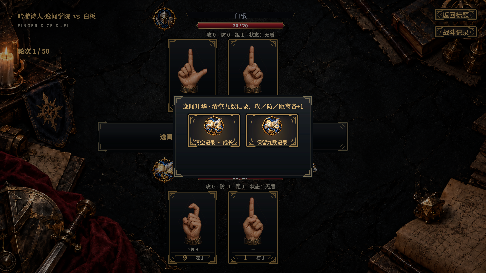
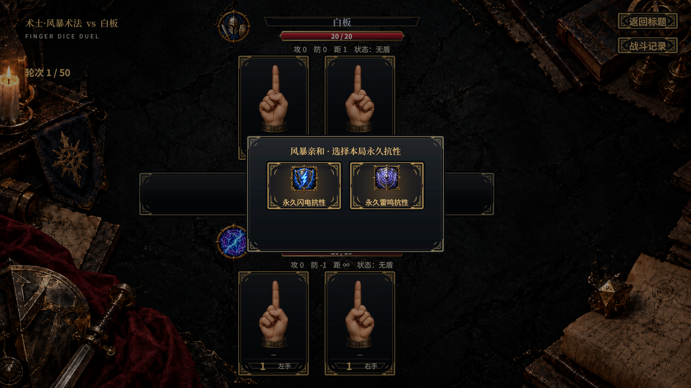
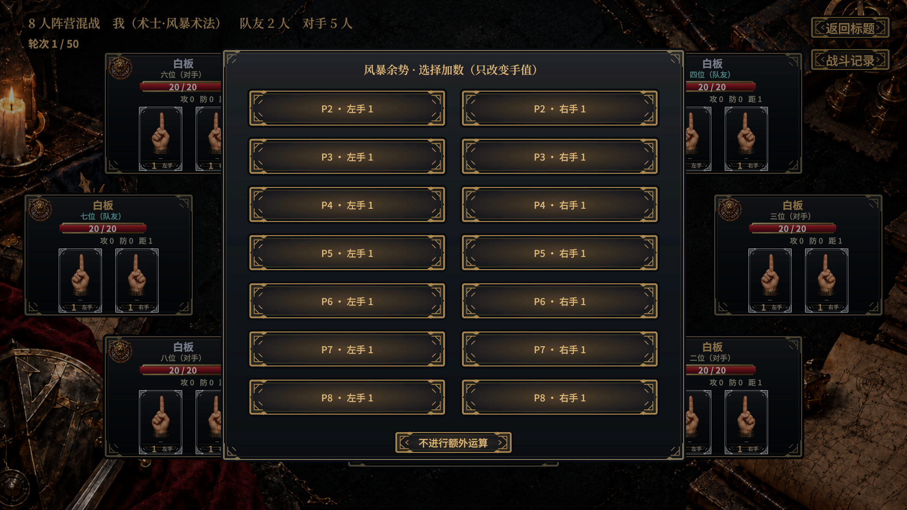
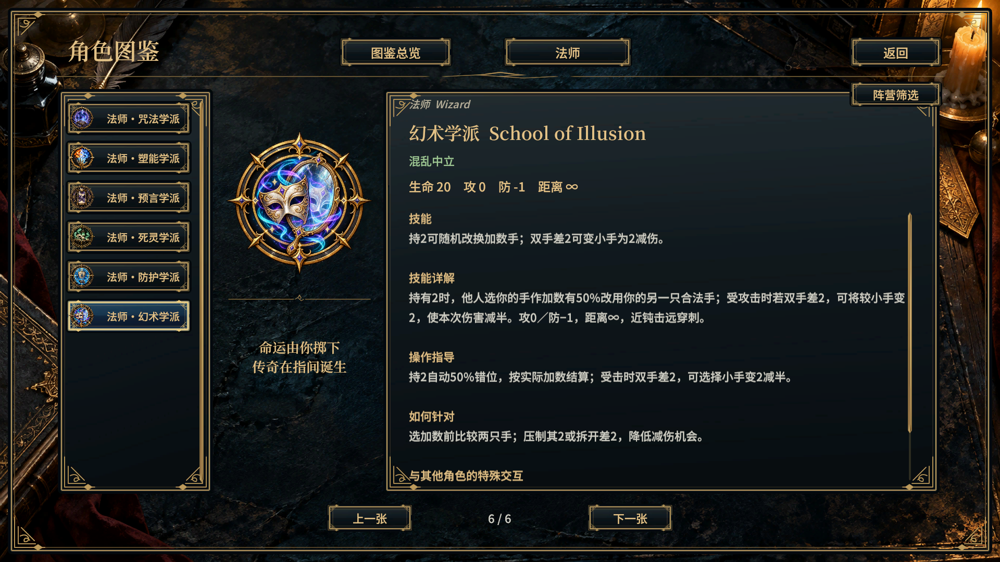

# 逸闻、风暴与幻术实机验收

团结引擎2022.3.62t15；[复现脚本](review.cs.txt)配合[点击与渲染助手](helpers.cs.txt)。[93项检查通过](validation.txt)，含23项逻辑测试在引擎再次执行。真实EventSystem射线点击并渲染1920×1080截图，没有写玩家通关记录或设置。

- 45角色选将中三枚新徽记加载且可点击；图鉴职业筛选为吟游诗人2、术士3、法师6，三行中英／阵营正确，文本无裁切。
- 逸闻第9数触发成长选择，确认后记录清空、攻防与射程增长；受击选清记录减半并实际付费，或保留。记录图标角标为进度，悬停列出数字。
- 幻术将所选2换成另一手7，实际1+7＝8进入攻击；折光选择后只将小手1变2，并将5伤减为3。
- 风暴开局选择雷鸣抗性，实际闪电攻击附感电；余势再算成9，没有回血或增加回合。随后对手感电正常开始结算，施法者承受相邻1伤，非额外运算伤害。
- 4／8人余势均展示全部6／14个合法加数，最后一个可点击；只改变自己的运算手。

其他原始截图同目录；[美术原图及精确提示词](../../Production/lore-storm-illusion-v1/README.md)。[1317项完整回归](headless-full.txt)、[Unity条件编译](unity-compile.txt)与[UI编译](ui-compile.txt)均通过；45角色×3难度×2/4/8人共405组控制器推进。
