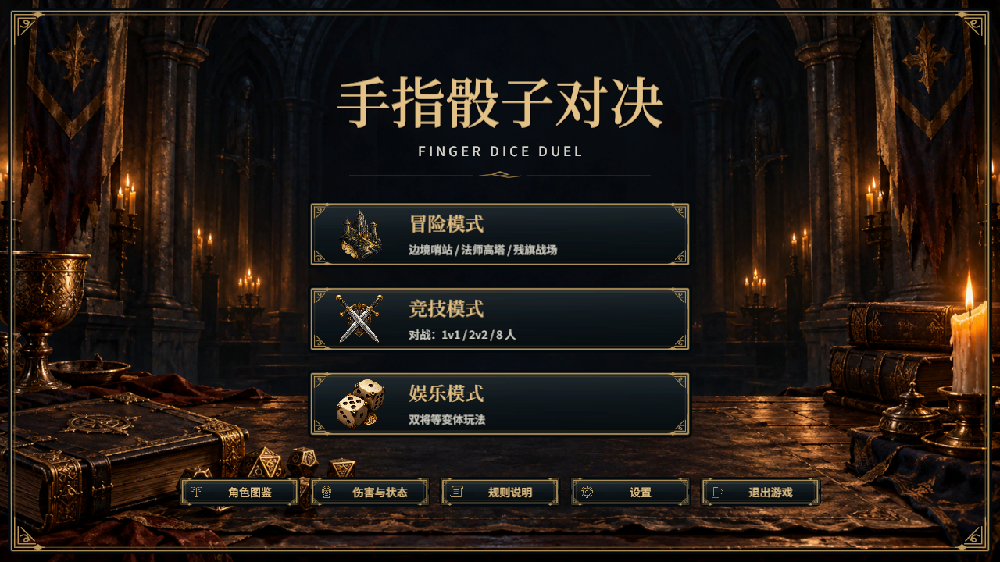
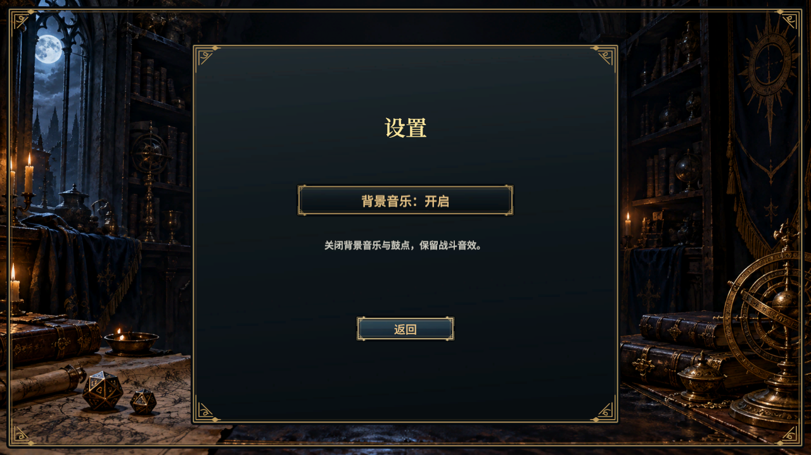
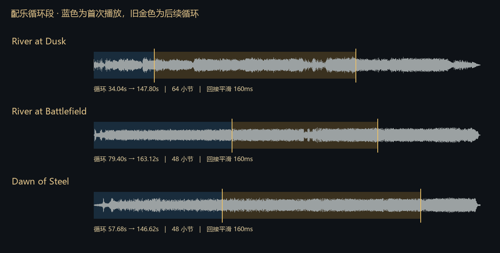

# 背景音乐与设置验收

2026-11-01。三首玩家提供的配乐已接入，循环、半血额外鼓层与主界面设置同步完成。[使用规则与循环段](../../../Docs/music-and-audio.md) · [源文件和导出](../../Production/music-v1/README.md)。

## 验证

- [功能回归](functional-tests.txt)：1576项通过、0失败，其中音乐策略7项；8项独立统计跳过，没有改动玩法或AI。
- [引擎检查](native-validation.txt)：48项通过，包括设置点击、保存与恢复、只静音音乐、菜单不中断、三章终战选曲、半血与回血保持、十份素材加载。真实播放三个intro末尾并由DSP调度进入loop；两份战斗曲目的主曲／鼓层长度一致且相位同步。
- [多人检查](multiplayer-validation.txt)：8项通过，真实2v2与8人布局下，非首两名角色达到半血同样触发鼓层。
- [音频文件检查](audio-validation.txt)：15项通过，三份FLAC保持原PCM，十份OGG解码采样数／立体声正确，无非有限数或削波，主曲与鼓层逐样本等长。
- Unity UI程序集与NUnit路径编译通过。截图为引擎原生Canvas输出；未后期修改。

## 复现

引擎导入后，通过项目Codely桥以editor模式执行[configure-import.csx](configure-import.csx)；进入Play后依次执行[validate-native.csx](validate-native.csx)和[validate-multiplayer.csx](validate-multiplayer.csx)，不要并发。脚本会保存并恢复音乐偏好、AI间隔及后台设置，返回主界面，不写入剧情通关进度。

循环验收临时将实际intro定位到最后1秒，并让实际loop在这一秒结束时按DSP计划开始，不用等待整首音乐；正常游戏仍完整播放开头。此项验证流式加载、播放衔接与鼓层相位，不将数值检查等同于人工听感审定。候选循环和节拍为自动估计，可按实际试听继续微调。

