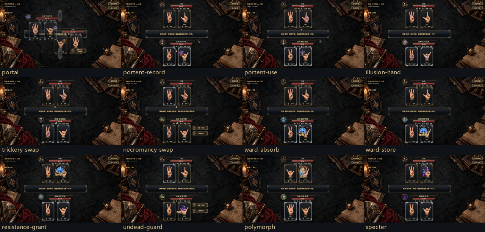
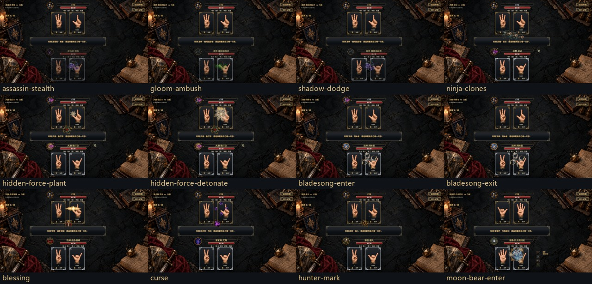
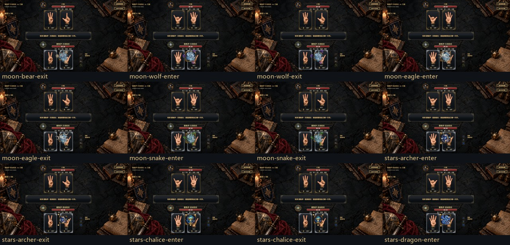
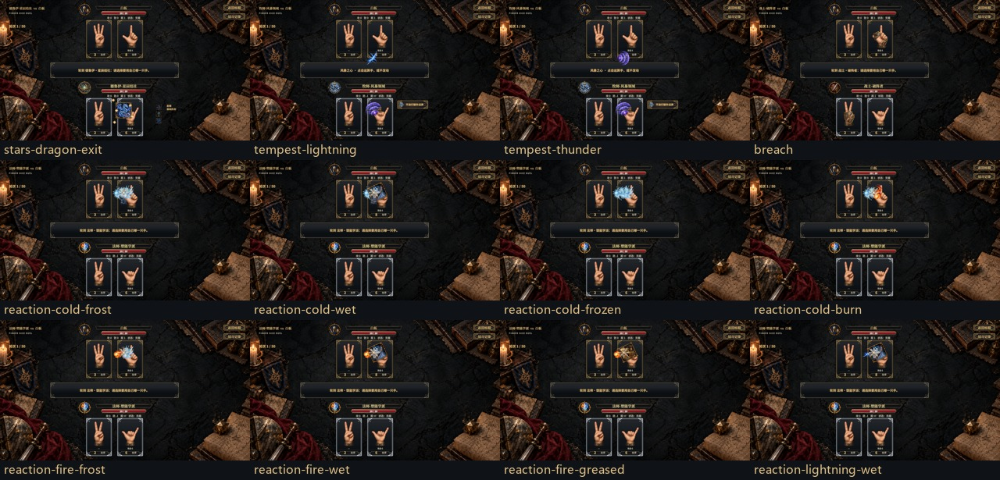
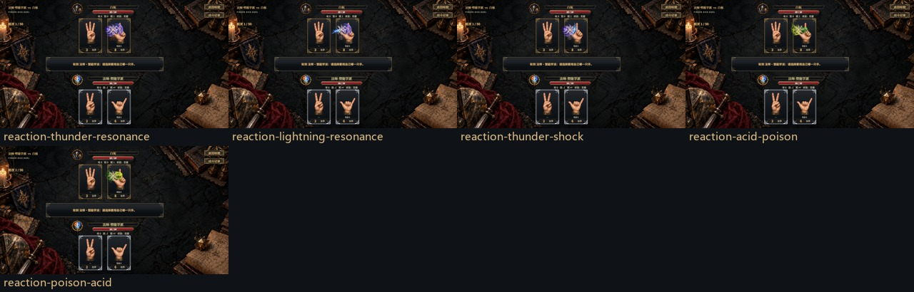

# 专属动画定稿与截图

2026-10-31。**53种播放变体，106张1280×720 PNG**。每种包含起势（进度0.28）与高峰（进度0.62）；它们是播放变体，不是53名角色。

截图来自Unity原生Canvas与生产播放器的同一个绘制方法；使用受控角色及技能数据审阅外观、落点、可读性，未把静态姿态预览当成真实规则触发。实际规则数据另由功能测试验证，异步队列由现场播放脚本验证。截图无后期绘画；以下总览仅缩放拼接原图。

P2／P3接入后，修正临时数字同帧清理与资源定位，15个相关片段已重拍；见[重拍报告](number-refresh.txt)和[片段清单](../animation-p2-p3/live-playback/p1-refreshed.json)。其余片段与原有验证记录保留。

## 总览

## 每项最终稿

| 片段 | 技能／变体 | 起势 | 高峰 |
|---|---|---|---|
| portal | 王车易位 | [截图](portal/windup.png) | [截图](portal/peak.png) |
| portent-record | 预兆 | [截图](portent-record/windup.png) | [截图](portent-record/peak.png) |
| portent-use | 预知未来 | [截图](portent-use/windup.png) | [截图](portent-use/peak.png) |
| illusion-hand | 幻术默发 | [截图](illusion-hand/windup.png) | [截图](illusion-hand/peak.png) |
| trickery-swap | 诡诈换位 | [截图](trickery-swap/windup.png) | [截图](trickery-swap/peak.png) |
| necromancy-swap | 不死奴仆 | [截图](necromancy-swap/windup.png) | [截图](necromancy-swap/peak.png) |
| ward-absorb | 奥术守御 | [截图](ward-absorb/windup.png) | [截图](ward-absorb/peak.png) |
| ward-store | 奥术守御 | [截图](ward-store/windup.png) | [截图](ward-store/peak.png) |
| resistance-grant | 法术抗性 · grant | [截图](resistance-grant/windup.png) | [截图](resistance-grant/peak.png) |
| undead-guard | 不死适应 | [截图](undead-guard/windup.png) | [截图](undead-guard/peak.png) |
| polymorph | 变形术 | [截图](polymorph/windup.png) | [截图](polymorph/peak.png) |
| specter | 咒缚幽灵 | [截图](specter/windup.png) | [截图](specter/peak.png) |
| assassin-stealth | 暗杀 | [截图](assassin-stealth/windup.png) | [截图](assassin-stealth/peak.png) |
| gloom-ambush | 伏击 | [截图](gloom-ambush/windup.png) | [截图](gloom-ambush/peak.png) |
| shadow-dodge | 阴影闪避 | [截图](shadow-dodge/windup.png) | [截图](shadow-dodge/peak.png) |
| ninja-clones | 影分身 | [截图](ninja-clones/windup.png) | [截图](ninja-clones/peak.png) |
| hidden-force-plant | 渗透劲 | [截图](hidden-force-plant/windup.png) | [截图](hidden-force-plant/peak.png) |
| hidden-force-detonate | 渗透劲 · detonate | [截图](hidden-force-detonate/windup.png) | [截图](hidden-force-detonate/peak.png) |
| bladesong-enter | 剑歌 | [截图](bladesong-enter/windup.png) | [截图](bladesong-enter/peak.png) |
| bladesong-exit | 剑歌 | [截图](bladesong-exit/windup.png) | [截图](bladesong-exit/peak.png) |
| blessing | 战争祭司 | [截图](blessing/windup.png) | [截图](blessing/peak.png) |
| curse | 咒剑诅咒 | [截图](curse/windup.png) | [截图](curse/peak.png) |
| hunter-mark | 猎人印记 | [截图](hunter-mark/windup.png) | [截图](hunter-mark/peak.png) |
| moon-bear-enter | 荒野形态 · moon_bear | [截图](moon-bear-enter/windup.png) | [截图](moon-bear-enter/peak.png) |
| moon-bear-exit | 解除荒野 · moon_bear | [截图](moon-bear-exit/windup.png) | [截图](moon-bear-exit/peak.png) |
| moon-wolf-enter | 荒野形态 · moon_wolf | [截图](moon-wolf-enter/windup.png) | [截图](moon-wolf-enter/peak.png) |
| moon-wolf-exit | 解除荒野 · moon_wolf | [截图](moon-wolf-exit/windup.png) | [截图](moon-wolf-exit/peak.png) |
| moon-eagle-enter | 荒野形态 · moon_eagle | [截图](moon-eagle-enter/windup.png) | [截图](moon-eagle-enter/peak.png) |
| moon-eagle-exit | 解除荒野 · moon_eagle | [截图](moon-eagle-exit/windup.png) | [截图](moon-eagle-exit/peak.png) |
| moon-snake-enter | 荒野形态 · moon_snake | [截图](moon-snake-enter/windup.png) | [截图](moon-snake-enter/peak.png) |
| moon-snake-exit | 解除荒野 · moon_snake | [截图](moon-snake-exit/windup.png) | [截图](moon-snake-exit/peak.png) |
| stars-archer-enter | 星耀形态 · stars_archer | [截图](stars-archer-enter/windup.png) | [截图](stars-archer-enter/peak.png) |
| stars-archer-exit | 解除星耀 · stars_archer | [截图](stars-archer-exit/windup.png) | [截图](stars-archer-exit/peak.png) |
| stars-chalice-enter | 星耀形态 · stars_chalice | [截图](stars-chalice-enter/windup.png) | [截图](stars-chalice-enter/peak.png) |
| stars-chalice-exit | 解除星耀 · stars_chalice | [截图](stars-chalice-exit/windup.png) | [截图](stars-chalice-exit/peak.png) |
| stars-dragon-enter | 星耀形态 · stars_dragon | [截图](stars-dragon-enter/windup.png) | [截图](stars-dragon-enter/peak.png) |
| stars-dragon-exit | 解除星耀 · stars_dragon | [截图](stars-dragon-exit/windup.png) | [截图](stars-dragon-exit/peak.png) |
| tempest-lightning | 风暴之怒 · lightning | [截图](tempest-lightning/windup.png) | [截图](tempest-lightning/peak.png) |
| tempest-thunder | 风暴之怒 · thunder | [截图](tempest-thunder/windup.png) | [截图](tempest-thunder/peak.png) |
| breach | 破阵强袭 | [截图](breach/windup.png) | [截图](breach/peak.png) |
| reaction-cold-frost | 元素反应 · cold_frost | [截图](reaction-cold-frost/windup.png) | [截图](reaction-cold-frost/peak.png) |
| reaction-cold-wet | 元素反应 · cold_wet | [截图](reaction-cold-wet/windup.png) | [截图](reaction-cold-wet/peak.png) |
| reaction-cold-frozen | 元素反应 · cold_frozen | [截图](reaction-cold-frozen/windup.png) | [截图](reaction-cold-frozen/peak.png) |
| reaction-cold-burn | 元素反应 · cold_burn | [截图](reaction-cold-burn/windup.png) | [截图](reaction-cold-burn/peak.png) |
| reaction-fire-frost | 元素反应 · fire_frost | [截图](reaction-fire-frost/windup.png) | [截图](reaction-fire-frost/peak.png) |
| reaction-fire-wet | 元素反应 · fire_wet | [截图](reaction-fire-wet/windup.png) | [截图](reaction-fire-wet/peak.png) |
| reaction-fire-greased | 元素反应 · fire_greased | [截图](reaction-fire-greased/windup.png) | [截图](reaction-fire-greased/peak.png) |
| reaction-lightning-wet | 元素反应 · lightning_wet | [截图](reaction-lightning-wet/windup.png) | [截图](reaction-lightning-wet/peak.png) |
| reaction-thunder-resonance | 元素反应 · thunder_resonance | [截图](reaction-thunder-resonance/windup.png) | [截图](reaction-thunder-resonance/peak.png) |
| reaction-lightning-resonance | 元素反应 · lightning_resonance | [截图](reaction-lightning-resonance/windup.png) | [截图](reaction-lightning-resonance/peak.png) |
| reaction-thunder-shock | 元素反应 · thunder_shock | [截图](reaction-thunder-shock/windup.png) | [截图](reaction-thunder-shock/peak.png) |
| reaction-acid-poison | 元素反应 · acid_poison | [截图](reaction-acid-poison/windup.png) | [截图](reaction-acid-poison/peak.png) |
| reaction-poison-acid | 元素反应 · poison_acid | [截图](reaction-poison-acid/windup.png) | [截图](reaction-poison-acid/peak.png) |

## 验证与复现

- [功能回归](functional-tests.txt)：1556项通过，8项独立胜率统计跳过；动画不改变AI或玩法，未重采样胜率。Unity UI程序集与NUnit路径编译通过。
- [实际现场播放](live-playback/runtime-validation.txt)：12种场景、56项检查，覆盖末击胜负、多段格挡、闪避／取消、代挡／转移、多人起手、跳过与输入恢复。
- [专属队列检查](queue-validation.txt)：53种变体顺序实际播放，另检查2v2和8人门户队列；临时数字清空、面板位置复原、输入解锁、路径锚点固定。
- [素材与清理检查](native-review.txt)：53个定稿样例的资源均加载，预览结束清理成功。

在Unity播放模式中，通过项目现有Codely `execute_csharp_script`执行[capture-native.csx](capture-native.csx)重拍；先完成脚本编译，并确保当前场景存在GameBootstrap。运行结束返回选角页，恢复AI思考间隔与后台运行设置。现场播放使用[live-playback/validate-runtime.csx](live-playback/validate-runtime.csx)，专属队列使用[validate-queue.csx](validate-queue.csx)，三个脚本须依次运行。

[manifest.json](manifest.json)登记每个片段、截图进度、SHA256和绘制源版本；[build-index.py](build-index.py)只负责无损压缩、缩略总览和索引。以后每个动画最终稿必须留截图，修改后重新截图并更新索引。

羊血池击破／到期恢复、幽灵消亡、猎人印记消耗、巨龙二次运算和圣杯额外回复沿用快照与状态框架，未作为本批独立最终稿登记。持续状态的后续专属循环仍见[完整制作清单](../../../Docs/skill-and-status-animation-list.md)。
