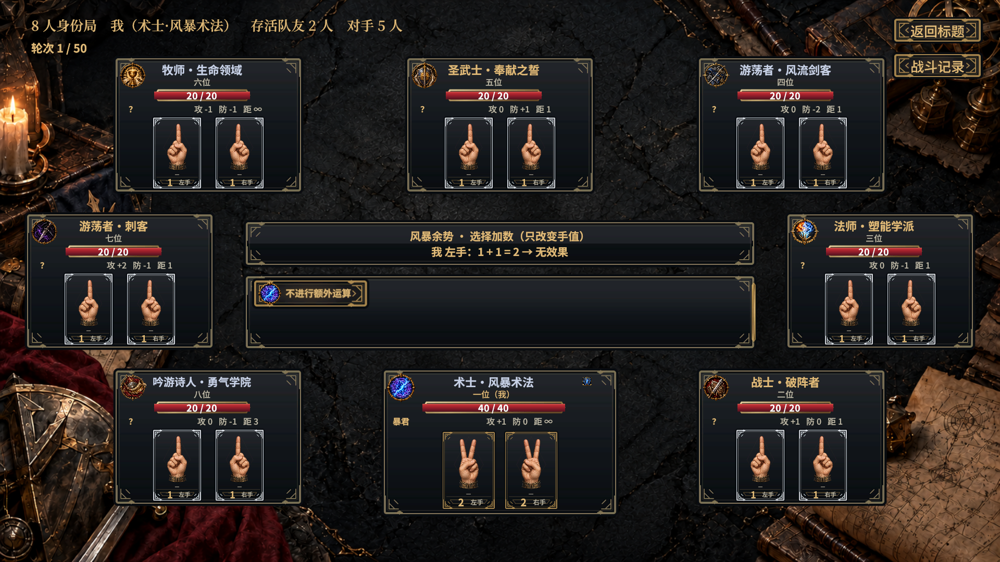
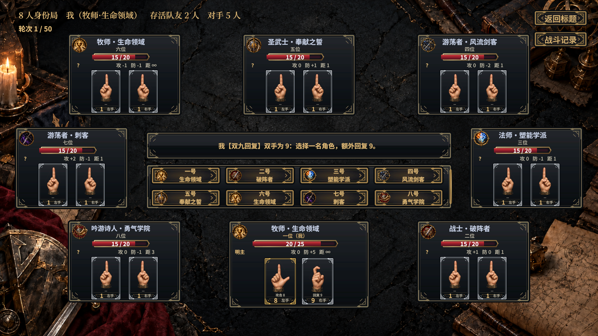

# 技能目标选择接入

2026-10-26。选手类技能统一直接点击战场手牌：保留合法候选描边与原控制器验证，不显示逐手按钮或遮挡战场的模态窗口。选角色类技能按人物去重列出按钮，显示座位、子职和目标徽记；元素、抗性、招式、形态、是否发动仍保留命名选项。

回合边界请求沿用 `WizardChoice.TargetsPlayer`，普通攻击前／防守请求按 `HandEffect`分类。纯发动确认与真实选手分开处理。可选技能保留不发动／结束选择；强制技能不增加取消出口。

已在真实编辑器验证：

- 1v1／2v2／8人风暴术法：先点运算手，再点加数；全部候选可达，额外运算只改手值，可放弃。
- 8人大地封锁：16只手直接点击；死者易手：先点自己的手，再点死者的手，可以提前结束。
- 2v2玩家防守：直接选择右手闪避，消耗正确手值，不伤害玩家。
- 8人连锁破盾：超过8个候选不再生成手按钮，最后一只盾可直接选中。
- 8人诅咒、双九治疗，以及防护抗性目标：角色列表按人物去重，点击能推进请求；六种抗性仍用类型面板。

153项实机检查通过，结果见[实机检查](validation.txt)，截图保留于本目录。阵营调整只更改五名子职的善恶轴，既有图鉴／阵营检查通过，392种双将组合不变；本次没有新增阵营测试或改动AI策略。

