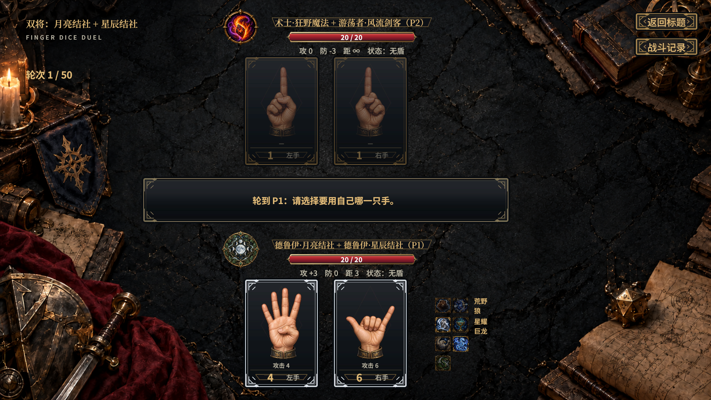

# 手指骰子对决 · Finger Dice Duel

一款暗色奇幻风格的2D回合制对战游戏：用两只手的数字运算发动攻击、回复与护盾，再利用职业技能、负面状态和座位距离争取胜利。

当前有 **12个职业、39个子职**，支持1v1、2v2、8人阵营／身份对局、双将组合与冒险剧情教学关。职业采用“职业·子职”命名；D&D元素融入角色设定与伤害体系，具体玩法以本游戏规则为准。

[开始游戏](#开始游戏) · [一回合怎么玩](#一回合怎么玩) · [模式规则](#模式规则) · [伤害与状态](#伤害与状态) · [完整角色图鉴](#完整角色图鉴) · [阵营分类](#阵营分类) · [胜率测试](#胜率测试) · [开发与文档](#开发与文档)

## 开始游戏

用团结引擎（Tuanjie）`2022.3.62t15`打开本目录，直接进入Play。入口自动启动，不需要配置场景或挂载预制体。当前以本地对AI练习为主，联网对战尚未实现。

初次体验推荐先玩 **冒险模式 → 剧情冒险 → 第一章：边境哨站 → 初战**：跟着老兵学会三步点击、4/6/8攻击、5合盾、9回血与满十归一；再进入**次战**，练习勇士的“十点重击”。随后可用 **1v1入门＋简单AI** 练手，再尝试经典投骰、多人距离与双将技能组合。

主菜单已接入各模式选将、先攻投骰、战斗、角色图鉴和秘法手册。选将可拖动大徽记列表；图鉴每页12名，支持职业与阵营组合筛选。战斗记录默认收起，点击“返回标题”下方的按钮展开；姓名旁的状态图标、形态提示均可悬停查看说明。



## 一回合怎么玩

每人通常 **20生命、左右各一只手**。入门模式从1/1开始；经典模式按1d20分配初始手值。普通手值为1～9，太极等技能可产生0。

1. 点自己的一只可用手，作为本回合的运算手。
2. 点另一名存活角色的一只可用手作加数；多人局可以用队友的手。通常不能用自己的手，魔术师等允许自加的技能另有例外。
3. 若结果为攻击，再选射程内的攻击目标；目标可以与提供加数的人不同。按界面提示完成主动技能、防御技能或治疗选择。

**只改变运算手，提供加数的手不变。** 结果取个位，0变1。例如3＋5＝8、9＋9＝8、1＋9＝1。

| 结果 | 基础效果 |
|---|---|
| **4 / 6 / 8** | 发起基础伤害为4 / 6 / 8的攻击 |
| **9** | 自己回复9点生命，不超过上限 |
| **5** | 这只手合成一面完整护盾 |
| **1 / 2 / 3 / 7** | 仅改变手值，不产生基础效果 |

效果只在运算产生结果时结算一次：手停在9不会每回合自动回血，初始分配的5也不是已经合成的盾。角色技能可改写数字效果，例如奉献之誓的4/6合盾、巨人道途的5攻击、狂战士道途的9攻击。

### 伤害、护盾和距离

普通攻击先按技能处理基础伤害，再计算 **max(0，基础伤害＋攻击加成−目标防御加成)**，最后按相关状态、抗性与防御技能结算。正防御减伤、负防御会增加承伤；固定伤害等技能有自己的例外。

例如基础4、攻击+1，对防御+1的目标造成4点伤害。勇士双手和10时，先将基础4乘1.5变6，再计算攻防。

- **护盾**：完整盾可挡一段攻击伤害，随后破碎；多段攻击逐段处理。主动使用完整盾那只手运算，会先自行碎盾。盾牌专用手型为五指并拢的5。
- **距离**：按存活角色座位环的最短距离计算，阵亡者移出环。攻击要求距离不超过射程；**∞**表示不受通常射程限制，状态限制仍需遵守。
- **加数与攻击目标分开**：能借到一只手的数字，不代表能打到这只手的主人。队友可以提供加数，也可以成为合法攻击目标，选目标时应注意。
- **跳过与放弃**：冻结、双手都无法运算等情况可跳过；部分技能允许主动跳过。没有合法攻击目标时，可放弃攻击并完成本次行动，已经产生的运算结果保留。

生命归零即阵亡。一轮指存活角色各经过一次正常行动；通常模式上限50轮，身份局80轮，跳过也会推进正常回合流程。

## 模式规则

| 模式 | 基本玩法 | 胜负与上限 |
|---|---|---|
| **剧情模式** | 第一章：边境哨站共五战，依次学习基本操作、勇士技能、破阵者技能、距离与经典先攻 | 前三战安全教学；四战完成远攻目标；五战真实对战，可败、可平局并重新投骰 |
| **1v1** | 各选一名子职，轮流运算、进攻与防守；有入门和经典两种开局 | 对手阵亡即胜；50轮到限比生命，相同平局 |
| **2v2** | 四人环形战场，1与4一队、2与3一队；借队友数字，结合治疗、射程和集火 | 敌队全灭即胜；50轮到限比全队生命总和，相同平局 |
| **双将对决** | 娱乐模式1v1，每人同时拥有两名同阵营子职的技能 | 与1v1相同，50轮到限比生命 |
| **8人阵营混战** | 守序／中立／混乱三队，人数3/3/2；可选单将或双将 | 只剩一个阵营即胜；50轮比阵营生命总和，并列平局 |
| **8人身份对局** | 1主公、2忠臣、4反贼、1内奸；隐藏身份、不同胜利目标与击杀奖惩 | 按身份目标判胜；80轮到限平局 |

剧情冒险先选“第一章：边境哨站”，再从可滚动列表进入初战至五战，本章共用专属哨站庭院背景。指引可“上一页／下一页／回到当前”翻阅已解锁文字，战斗进度保持不变。

| 战斗 | 学习内容 |
|---|---|
| [初战](Docs/Adventure/level-01.md) | 攻击、合盾、碎盾、回复与满十归一，7步引导 |
| [次战](Docs/Adventure/level-02.md) | 勇士十点重击：运算后自身双手和10，基础伤害先×1.5再算攻防，自动发动 |
| [三战](Docs/Adventure/level-03.md) | 破阵者受击连锁破盾、合盾修复、主动用盾攻击附流血；7步后安全练习 |
| [四战](Docs/Adventure/level-04.md) | 左右石头占座，两手为−、不可选；双方距离2，先体验超距放弃，再合盾、碎盾换本次距离∞，命中完成训练 |
| [五战](Docs/Adventure/level-05.md) | 真实1d20经典先攻，小点先分配、大点先行动；破阵者对战白板教官，自由攻防，AI可击败玩家 |

各战独立通关、重打与返回；前三战完成后可跳过到安全练习，四战重打保留指引，五战每次重新投骰，不设必胜保护。前三战的安全阶段教官不进攻、不回复、不新增盾，无安全运算则休整。五战失败或平局不增加通关记录。挑战模式仍预留。[最新界面验收](Art/Integration/adventure-later-training/README.md)。

### 1v1与经典先攻

入门不掷骰，双方1/1开始，可选简单／普通／困难AI。经典先各投 **1d20**，决定手值与先手，不提供难度选择：

| 骰点 | 初始手值分配 |
|---|---|
| 2～18 | 两只手各为1～9，总和等于骰点；例如8可选1/7、2/6等 |
| 1：大失败 | 由对手替自己自由指定两只手 |
| 19：小成功 | 至少一只手是9，另一只任意1～9 |
| 20：大成功 | 两只手各自自由选择1～9 |

点数小的先分配，大的后分配并先行动；同点同时分配，双1则同时替对手指定。后决定者能看到先前确定的手值。**初始数字不会直接发动攻击、回复、合盾或潜行。**

### 2v2的协作与站位

座位按1→2→3→4→1形成环，队友相邻，初始对角距离2。入门可选座位，固定困难AI；经典由四人投骰定座位：比较两队最大骰点，再比最小骰点，较大的一队坐1与4，其余坐2与3，仍同则随机。

经典手值通常按 **4→3→2→1** 依次分配；大失败先由配对对手代选，大成功最后自选，1号位先行动。队友阵亡后仍可继续战斗，死亡座位移出距离环。配合可以是给队友治疗，也可以是保留让队友容易凑出攻击／合盾的手值。

### 双将怎样组合

两名子职必须不同，并同属 **守序、中立、混乱** 中的一类；善良／中立／邪恶这一轴不限制搭配。玩家选自己的主副将，AI随机搭配；当前各阵营13名，共 **234种无序组合**，主副顺序可能影响技能优先级。

| 合并项目 | 规则 |
|---|---|
| 攻击、防御加成 | 两名子职相加 |
| 生命上限、射程、攻击段数 | 取两者中较大值，不相乘 |
| 技能 | 独立触发的技能共同保留；数字改写按各自负责的数字处理 |
| 同一步骤发生竞争 | 按主将优先等对应规则处理；同阵营不代表所有效果可无条件叠乘 |
| 形态 | 月亮与星辰结社可以同时保持形态，各自选择与解除 |

例如魔术师＋巨人道途由魔术师提供自加能力：2是攻击，4/6/8无效果，5两段攻击，9两段回复。完整结算例外见[RULES双将规则](RULES.md#827-双将模式)。

### 8人阵营混战

三队人数3/3/2，哪队为2人每局随机。单将使用8个不同角色；双将每人带两名同阵营子职，尽量不重复角色。场面按环形距离计算，敌方阵营是主要进攻目标。

直接攻击击杀敌方后，击杀者额外行动X次，X为被击杀阵营剩余人数；击杀同阵营角色，则从下家开始，其他阵营的存活角色各额外行动一次。额外行动不推进正常轮次，奖惩可嵌套；中毒、燃烧、太极反弹等不计入此击杀奖励。

### 8人身份对局

| 身份 | 人数 | 目标与关键特点 |
|---|---:|---|
| 主公 | 33.3% | 35.1% |
| 忠臣 | 33.3% | 35.1% |
| 反贼 | 51.4% | 50.2% |
| 内奸 | 14.4% | 13.4% |

人类在AI练习中随机获得身份，自己可见；主公始终公开，其他身份通常阵亡后公开。主公生命上限+5、攻防各+1，另按阵营获得存活同阵营人数驱动的称号增益：守序加防、中立加攻、混乱加生命上限。

内奸亮身份时生命上限+5、回复5、攻防各+1。主公属于最先阵亡的三人时，反贼立即胜；内奸亮身份后主公死亡且仍有反贼，会清除忠臣并转为内奸对反贼。无反贼时主公死亡，有忠臣则反贼胜、无忠臣则内奸胜。击杀反贼可获得按剩余反贼数计算的额外行动，主公误杀忠臣会让存活反贼依次行动。详细身份优先级见[RULES](RULES.md#19-8-人身份对局)。

## 伤害与状态

### 13种伤害类型

所有攻击都有类型。类型影响抗性、状态和元素反应，**魔法伤害同样计算攻防**，除非技能明确无视或固定伤害。表中状态是具有对应附加能力时的通常结果；光明领域的光耀攻击以专属圣光替代通常目盲。

| 类别 | 类型 | 通常效果或用途 |
|---|---|---|
| 物理 | 挥砍 Slashing | 刀剑斩击等；不自动附状态，流血由具体技能赋予 |
| 物理 | 钝击 Bludgeoning | 钝器、掌击等；不自动附状态 |
| 物理 | 穿刺 Piercing | 箭矢、刺击等；类型本身不等于穿盾 |
| 魔法 | 雷鸣 Thunder | 附残响，限制攻击距离；重复命中残响可触发眩晕 |
| 魔法 | 强酸 Acid | 附强酸，降低防御 |
| 魔法 | 毒素 Poison | 附中毒，回合开始持续伤害 |
| 魔法 | 光耀 Radiant | 通常附目盲，限制可借用的手 |
| 魔法 | 暗蚀 Necrotic | 附腐朽，阻止回复 |
| 魔法 | 火焰 Fire | 附燃烧，回合结束持续伤害 |
| 魔法 | 寒冷 Cold | 附覆霜，削弱运算；与覆霜／潮湿联动冻结 |
| 魔法 | 闪电 Lightning | 附感电，影响目标和相邻角色 |
| 魔法 | 力场 Force | 穿盾、无视正向防御、不可闪避；不附通常状态，取消／转移等按技能规则处理 |
| 魔法 | 心灵 Psychic | 50%附恐慌、50%附震慑，持续2回合 |

附状态与直接伤害是两个判定：具有“命中附加”能力时，盾挡和太极减免通常仍算命中；闪避或取消不算命中。战斗大师等要求“实际伤害大于0”的技能另有例外。

### 19种负面状态

通常持续 **目标自己的2个回合**，不是全场行动两次；同种再次施加只刷新时间，不叠加强度。龙族血脉的对应状态为3回合，技能另有说明时优先。

| 状态 | 对玩法的影响 |
|---|---|
| 残响 | 只能攻击距离1的角色 |
| 强酸 | 防御−2 |
| 中毒 | 自己回合开始受2点毒素伤害，不可抵挡 |
| 目盲 | 只能借距离1以内角色的手作加数；合法自加仍可用 |
| 腐朽 | 不能回复生命 |
| 燃烧 | 自己回合结束受3点火焰伤害，可被盾／闪避／太极处理 |
| 覆霜 | 运算结果减半、向下取整，最低1；到期后附2回合潮湿 |
| 感电 | 自己回合开始，自己与环上相邻角色各受1点闪电伤害，可被防御机制处理 |
| 恐慌 | 攻击−2，且不能攻击施加者 |
| 流血 | 攻防各−1；自己回合开始失去1生命，不可抵挡 |
| 潮湿 | 运算结果−1，最低1 |
| 冻结 | 无法行动，通过跳过完成回合 |
| 震慑 | 不能攻击，但仍可完成其他合法操作 |
| 跛脚 | 攻击距离减半，最低1 |
| 倒伏 | 受到的伤害×1.5，向上取整；固定伤害等例外按技能处理 |
| 魅惑 | 由AI随机选择合法行动 |
| 失能 | 攻击伤害为0，仍保留攻击效果 |
| 眩晕 | 本次运算结果无效，不触发技能 |
| 圣光 | 立即清除其他状态与全部抗性，持续期间阻止新附加；回合开始失去1生命、不可抵挡，回复减半并向上取整；勇气战歌和奥术屏障不被清除 |

覆霜／潮湿会改变最终结果及对应效果：例如原本算出9，覆霜使其变4，就按4的效果处理。中毒、燃烧、感电的持续伤害不会反复给自己追加同一状态。

### 六条元素反应

| 本次伤害＋已有状态 | 命中后的反应 |
|---|---|
| 雷鸣＋残响 | 清残响，附2回合眩晕 |
| 寒冷＋覆霜／潮湿 | 清除这两种状态，附2回合冻结 |
| 寒冷＋冻结 | 伤害×1.5，保留冻结，不附覆霜 |
| 寒冷＋燃烧 | 清燃烧，伤害×1.5，不附覆霜 |
| 火焰＋覆霜／潮湿 | 清除这两种状态，伤害×1.5，不附燃烧 |
| 闪电＋潮湿 | 伤害×1.5，保留潮湿，照常附感电 |

反应只在命中后触发；盾挡／太极减免仍算命中，闪避／取消不算。反应增伤在常规伤害上乘1.5并向上取整。心灵的概率状态属于伤害类型效果，不另列为元素反应。

### 抗性、屏障与角色标记

| 项目 | 作用 |
|---|---|
| 抗性 | 对应类型伤害减半，向上取整；临时抗性在一次实际受伤后一起清除，盾挡／闪避不消耗；永久抗性不按此方式消耗，圣光可清除 |
| 防护学派可授抗性 | 仅物理整组（挥砍／钝击／穿刺）、雷鸣、强酸、火焰、寒冷、闪电六项；不能授心灵／力场／毒素／光耀／暗蚀抗性 |
| 奥术屏障 | 护盾与抗性后、扣血前吸收；使用即全部清空，点数显示在图标上 |
| 气 | 散打宗、四象宗专属资源；角标为当前气点，0点仍显示 |
| 共鸣之气 | 散打宗挂上的专属标记，后续攻击可引爆额外真实伤害；与雷鸣“残响”是不同机制 |
| 猎人标记 | 显示在被标记者旁，由对应猎人的攻击消耗；多来源时角标表示来源人数 |
| 德鲁伊形态 | 面板右侧显示4种荒野／3种星耀形态，当前高亮；是角色形态，不占上述19种负面状态名额 |

## 完整角色图鉴

以下覆盖全部 **39个子职**。职业用于归类，不额外赋予通用技能；技能以“职业·子职”的完整身份生效。表中生命与攻防是开局常态值，动态成长、形态、状态与身份加成另算；射程∞仍需遵守残响、恐慌等限制。

游戏内图鉴还能查看详细操作、应对方式及需要解释的特殊交互；完整结算以[RULES](RULES.md)为准。

### 战士 Fighter（6）

| 子职 | 生命 | 攻 / 防 | 射程 | 技能与操作要点 |
|---|---:|---|---|---|
| 勇士<br>Champion | 20 | +1 / 0 | 1 | 十点重击：运算后、发起攻击时双手和为10，基础伤害×1.5，再算攻防；自动触发。 |
| 破阵者<br>Breaker | 20 | +1 / 0 | 1 | 己方盾碎可连锁破盾，合盾可修复；以完整盾作运算源，或碎另一盾换本次射程∞后攻击，命中附流血2回合。 |
| 魔射手<br>Arcane Archer | 20 | 0 / −1 | 3 | 4改为两段各4；6基础伤害+2；8无视护盾。三种攻击仍分别计算攻防。 |
| 剑士<br>Swordsman | 20 | +2 / −1 | 1 | 运算后双手同为4/6/8，主攻击前可追加一次同值、无视双方攻防的攻击；追加命中附流血2回合。 |
| 战术家<br>Tactician | 20 | +1 / −1 | 1 | 额外攻防各+X，X为场上最高与最低生命差÷3，向下取整；随局面实时变化。 |
| 战斗大师<br>Battle Master | 20 | 0 / 0 | 2 | 4挥砍、6钝击、8穿刺；实际造成伤害后，另一手4/8可附流血或跛脚，另一手6可附震慑或倒伏，均2回合。 |

### 圣武士 Paladin（3）

| 子职 | 生命 | 攻 / 防 | 射程 | 技能与操作要点 |
|---|---:|---|---|---|
| 王冠之誓<br>Oath of the Crown | 20 | +1起 / −1 | 1起 | 王冠威仪：自己的盾每破碎一次，攻击距离永久+1；攻击加成始终等于攻击距离，初始均为1。 |
| 奉献之誓<br>Oath of Devotion | 20 | 0 / +1 | 1 | 4/6改为合盾；合盾、主动碎盾或挨打碎盾时，对范围内一人造成2点固定冲击。可替攻击范围内角色承受攻击。 |
| 破誓者<br>Oathbreaker | 20 | +2 / 0 | 1 | 5改为5点钝击攻击；被攻击时若有5，可将整次攻击转给另一名持完整盾的非攻击者，也可不发动。 |

### 牧师 Cleric（3）

| 子职 | 生命 | 攻 / 防 | 射程 | 技能与操作要点 |
|---|---:|---|---|---|
| 生命领域<br>Life Domain | 20 | −1 / −1 | ∞ | 4/6/8可改为等量治疗；9可选治疗目标，双9再治疗一次。每段治疗先清除目标全部负面状态，满血也净化。 |
| 光明领域<br>Light Domain | 20 | 0 / −1 | ∞ | 普通攻击固定4点光耀，不吃攻防和伤害倍率；命中附圣光2回合，清其他状态与抗性，并压制后续状态、抗性及回复。 |
| 战争领域<br>War Domain | 20 | 0 / −1 | ∞ | 发起或受到一次攻击后攻防各+1，可叠加；自己回合结束时若未发起攻击，加成全部清空。 |

### 野蛮人 Barbarian（4）

| 子职 | 生命 | 攻 / 防 | 射程 | 技能与操作要点 |
|---|---:|---|---|---|
| 守望者道途<br>Path of the Warden | 20 | 0 / +1 | 1 | 合盾时可锁定对手一只手，自己的对应盾碎后解锁；只剩两人时最多维持一只锁手，多人时可锁两只。 |
| 狂战士道途<br>Path of the Berserker | 25 | −1 / −2 | 1 | 9改为9点挥砍攻击；每损失5生命，攻防各+1；造成伤害后回复其一半，向下取整。 |
| 巨人道途<br>Path of the Giant | 25 | +2 / +2 | 1 | 4/6/8无效果；5改两段攻击，9改两段回复，每段基础量均为另一只手点数。 |
| 野兽道途<br>Path of the Beast | 25 | −2 / −2 | 1 | 运算后双手直接相加等于7，回复生命上限的一半，并永久攻防各+1；不是单手合出7。 |

### 武僧 Monk（4）

| 子职 | 生命 | 攻 / 防 | 射程 | 技能与操作要点 |
|---|---:|---|---|---|
| 太极宗<br>Way of the Tai Chi | 20 | 0 / 0 | 1 | 5进入太极；受攻击时可将5变0，承受一半伤害并反弹其余。0被他人作加数触碰后变1；空间刃穿透太极。 |
| 忍宗<br>Way of the Ninja | 20 | +1 / −1 | 1 | 攻击基础伤害减半、拆为两段，每段各自计算攻防及防御机制；多段更容易消耗护盾。 |
| 散打宗<br>Way of the Open Hand | 20 | 0 / 0 | 1 | 开局2气、上限6，运算后双手相同得1气；攻击可花2气附倒伏/震慑，或4气挂共鸣，后续攻击引爆半伤真实伤害。气等于生命时可跳过并耗尽气，回复2倍气点。 |
| 四象宗<br>Way of the Four Elements | 20 | 0 / 0 | 1 | 开局2气、上限6，运算后双手相同得1气；花2气选择火焰/寒冷/闪电/雷鸣/强酸攻击；受这五类攻击时有气则自动耗1气获得对应抗性。 |

### 游侠 Ranger（2）

| 子职 | 生命 | 攻 / 防 | 射程 | 技能与操作要点 |
|---|---:|---|---|---|
| 幽域追踪者<br>Gloom Stalker | 20 | 0 / −1 | 1（伏击 3） | 运算后双手同为1/2/3，可暗置运算手进入伏击：攻+1、射程3；暗手不能运算或作加数，数值可见。挨打时解除并挡伤，空间刃穿透但不解除。 |
| 猎人<br>Hunter | 20 | 0 / −1 | 3 | 7可标记射程内一名其他角色；攻击可额外带上射程内的标记目标。打标记者无视正防御，增伤为其已损生命÷5，向下取整，随后消耗标记。 |

### 游荡者 Rogue（5）

| 子职 | 生命 | 攻 / 防 | 射程 | 技能与操作要点 |
|---|---:|---|---|---|
| 风流剑客<br>Swashbuckler | 20 | 0 / −2 | 1 | 受攻击可用1→2完全闪避；攻击时可将另一只2→3，基础伤害×1.5且射程∞，命中附流血2回合。 |
| 盗贼<br>Thief | 20 | 0 / −1 | 1 | 可放弃运算改为交换双方一只手的点数；原值≥偷来值时，由偷来数字触发效果，否则只交换。偷窃距离∞、可偷队友，不能连续两次行动偷窃。 |
| 刺客<br>Assassin | 20 | +2 / −1 | 1 | 经运算达成双7进入潜行，不能被攻击；每次潜行可跳过一次行动。解除潜行发起攻击时+7，命中附流血2回合。 |
| 魔术师<br>Magician | 20 | 0 / −1 | 2 | 可用自己的另一只手作加数；2/4/6/8均为对应点数攻击，吃攻防加成。一只手不能加自己。 |
| 赌徒<br>Gambler | 20 | 0 / 0 | 1 | 可放弃运算，选自己一只手掷1d9，直接以点数作为结果；上次行动是正常运算，则本次必须赌博。 |

### 吟游诗人 Bard（1）

| 子职 | 生命 | 攻 / 防 | 射程 | 技能与操作要点 |
|---|---:|---|---|---|
| 勇气学院<br>College of Valor | 20 | 0 / −1 | 3 | 本回合受伤或实际回血后，可给射程内1～3人（含自己）增减攻击或防御。1人±3、2人±2、3人±1，持续到下次发动或自己死亡。 |

### 法师 Wizard（5）

| 子职 | 生命 | 攻 / 防 | 射程 | 技能与操作要点 |
|---|---:|---|---|---|
| 咒法学派<br>School of Conjuration | 20 | −1 / 0 | ∞ | 空间刃穿盾、无视正防御且不可闪避。王车易位可跳过，与双手值相同的存活角色换座（4/6视同6/4）；距离立即变、队伍不变，本轮原顺序、下轮新顺序。 |
| 塑能学派<br>School of Evocation | 20 | 0 / −1 | 1 | 4/6/8可放弃本次攻击，为下次攻击选一种魔法伤害类型。命中附对应状态；盾挡仍附加，闪避/取消则本次附魔作废；重新选择覆盖旧类型。 |
| 预言学派<br>School of Divination | 20 | 0 / −1 | ∞ | 7开启至自己下回合开始的预言窗口，记录另一只手；他人行动时若任一手值等于该快照，本次行动无效、不触发技能。 |
| 死灵学派<br>School of Necromancy | 20 | 0 / −1 | ∞ | 受击可用2→1挡一段（力场除外）；回合开始有可用1，可免费选目标打1点暗蚀附腐朽，也可放弃，不耗正常行动。有人死亡可与死者交换0～2对手值。 |
| 防护学派<br>School of Abjuration | 20 | 0 / −1 | ∞ | 2先选存活角色，再赋物理整组或雷鸣/强酸/火焰/寒冷/闪电抗性；攻击数字可改存奥术屏障，扣血前吸收后全部清空。 |

### 术士 Sorcerer（2）

| 子职 | 生命 | 攻 / 防 | 射程 | 技能与操作要点 |
|---|---:|---|---|---|
| 狂野魔法<br>Wild Magic | 20 | 0 / −1 | ∞ | 每段攻击各8%变成10种魔法类型之一（共80%）并按规则附状态，余20%普通攻击；多段逐段掷骰，自动发动。 |
| 龙族血脉<br>Draconic Bloodline | 20 | 0 / −1 | ∞ | 首次自己回合选寒冷/火焰/闪电/毒素/强酸，之后攻击固定为该类型，并获其永久抗性；对应状态持续3回合，重开重新选择。 |

### 邪术师 Warlock（2）

| 子职 | 生命 | 攻 / 防 | 射程 | 技能与操作要点 |
|---|---:|---|---|---|
| 至高妖精<br>The Archfey | 20 | 0 / −1 | ∞ | 有人攻击时，可将自己与攻击数字相同的手+1，取消攻击；生命不满时可跳过，将一名角色的生命改为与自己一致。 |
| 旧日支配者<br>The Great Old One | 20 | 0 / −1 | ∞ | 命中后自己与目标距离+2，持续目标自己的2回合；重复命中刷新、不叠加。近距离挥砍、远距离穿刺。 |

### 德鲁伊 Druid（2）

| 子职 | 生命 | 攻 / 防 | 射程 | 技能与操作要点 |
|---|---:|---|---|---|
| 月亮结社<br>Circle of the Moon | 20 | 0 / 0 | 1 | 回合开始双手和10，可选熊/狼/鹰/蛇；回合结束双手相同，可解除或保留。形态不能直接互切，具体加值见下表。 |
| 星辰结社<br>Circle of the Stars | 20 | 0 / 0 | 3 | 回合开始双手和10，可选射手/圣杯/巨龙；回合结束双手相同，可解除或保留。射程3，具体加值见下表。 |

### 德鲁伊形态速查

回合开始双手点数直接相加为10时选择形态，可保持基础；回合结束双手相同时可解除或保留，不能直接换形态。双将月亮＋星辰可同时保留两种形态，独立解除；攻防相加、射程取大，伤害类型冲突按主将优先。

| 结社 | 形态 | 攻 / 防 | 射程 | 效果 |
|---|---|---|---|---|
| 月亮 | 熊 | −1 / +2 | 1 | 4改为合盾 |
| 月亮 | 狼 | +2 / −1 | 1 | 回复攻击实际伤害的一半，向下取整 |
| 月亮 | 鹰 | +1 / −1 | 3 | 攻击全为穿刺，6不发起攻击 |
| 月亮 | 蛇 | 0 / 0 | 1 | 毒素攻击，命中附中毒 |
| 星辰 | 射手 | +2 / −1 | 3 | 光耀攻击，命中附目盲 |
| 星辰 | 圣杯 | 0 / 0 | 3 | 9回复后可额外给另一名存活角色回复9，也可放弃 |
| 星辰 | 巨龙 | +1 / +1 | 3 | 同一运算手连续加两次，第二个加数可重复第一次的同一只手；每次都归一化，最终只结算一次效果 |

## 阵营分类

阵营有两条轴：**守序／中立／混乱** 与 **善良／中立／邪恶**。“绝对中立”指两轴均中立。双将及阵营混战按第一条轴分组，职业不限制跨职业组双将。

| | 善良 | 中立 | 邪恶 |
|---|---|---|---|
| **守序（13名）** | 圣武士·王冠之誓<br>圣武士·奉献之誓<br>牧师·生命领域<br>吟游诗人·勇气学院<br>法师·防护学派 | 战士·破阵者<br>战士·魔射手<br>战士·剑士<br>战士·战斗大师<br>牧师·战争领域<br>法师·咒法学派 | 圣武士·破誓者<br>邪术师·至高妖精 |
| **中立（13名）** | 战士·勇士<br>牧师·光明领域<br>武僧·太极宗<br>游侠·猎人 | 武僧·忍宗<br>武僧·散打宗<br>武僧·四象宗<br>法师·塑能学派<br>法师·预言学派 | 野蛮人·狂战士道途<br>游荡者·盗贼<br>法师·死灵学派<br>邪术师·旧日支配者 |
| **混乱（13名）** | 战士·战术家<br>野蛮人·守望者道途<br>游侠·幽域追踪者<br>游荡者·风流剑客<br>德鲁伊·月亮结社 | 游荡者·刺客<br>游荡者·魔术师<br>游荡者·赌徒<br>术士·狂野魔法<br>术士·龙族血脉<br>德鲁伊·星辰结社 | 野蛮人·巨人道途<br>野蛮人·野兽道途 |

三组各13名，每组可组成C(13,2)＝78种无序双将，合计234种。善恶分类用于完整角色设定；同组是否可选看守序轴，不要求善恶轴一致。图鉴职业筛选与阵营筛选取交集。

## 胜率测试

以下为 **2026-10-24当前39角色版本** 的已生成报告，使用现有测试驱动与AI策略。它们用于观察模式差异及回归，不能直接视为真人对局强度榜；不同模式的队伍、采样和胜率分母不同，不跨列相加或混算。打满轮次上限后按规则判胜，不等于平局。

| 测试 | 样本规模与口径 | 完整报告 |
|---|---|---|
| 1v1 | 39角色两两循环，每对80局，共59,280局；胜率＝胜局／全部出场，平局不算胜 | [1v1报告](Tools/1v1-report.txt) |
| 2v2 | 741种双人队伍的测试采样，共94,848局；角色列记“该角色所在队伍”的胜率，每角色出场9,728次 | [2v2报告](Tools/2v2-report.txt) |
| 双将1v1 | 234组合、27,261对，每对24局并交换座位，共654,264局；报告采用剔除真正平局的决胜胜率 | [双将报告](Tools/dual-report.txt) |
| 8人阵营 | 全AI双将抽样2,000局；以下阵营胜率按整局计，不是单将八人测试 | [阵营报告](Tools/8p-report.txt) |
| 8人身份 | 随机选角、身份偏好选角各2,000局；身份胜率按该身份出场计算 | [随机身份](Tools/identity-report-random.txt)／[偏好身份](Tools/identity-report.txt) |
| 2v2集火对照 | 每角色600局×2段种子×3策略，共140,400局；同局只改变受试角色策略 | [集火报告](Tools/focus-report.txt) |

### 全角色胜率

为方便选角，按职业排列。双将列统计该子职参加的所有双将组合表现，**不是某一固定搭配的胜率**。

| 角色 | 1v1胜率 | 2v2队伍胜率 | 双将决胜胜率 |
|---|---:|---:|---:|
| 战士·勇士 | 47.6% | 40.8% | 54.0% |
| 战士·破阵者 | 48.6% | 54.7% | 52.9% |
| 战士·魔射手 | 49.0% | 50.9% | 50.5% |
| 战士·剑士 | 49.7% | 55.8% | 51.9% |
| 战士·战术家 | 49.9% | 64.0% | 48.8% |
| 战士·战斗大师 | 49.3% | 54.1% | 49.5% |
| 圣武士·王冠之誓 | 48.8% | 40.2% | 50.7% |
| 圣武士·奉献之誓 | 49.5% | 62.8% | 50.1% |
| 圣武士·破誓者 | 48.8% | 52.2% | 49.6% |
| 牧师·生命领域 | 49.3% | 54.9% | 51.8% |
| 牧师·光明领域 | 50.2% | 30.8% | 48.7% |
| 牧师·战争领域 | 48.8% | 79.1% | 49.4% |
| 野蛮人·守望者道途 | 48.8% | 44.4% | 51.3% |
| 野蛮人·狂战士道途 | 49.5% | 65.5% | 48.3% |
| 野蛮人·巨人道途 | 52.2% | 57.9% | 49.7% |
| 野蛮人·野兽道途 | 50.7% | 27.9% | 51.0% |
| 武僧·太极宗 | 48.1% | 32.8% | 50.1% |
| 武僧·忍宗 | 50.4% | 31.1% | 51.3% |
| 武僧·散打宗 | 50.4% | 59.8% | 48.5% |
| 武僧·四象宗 | 50.9% | 52.3% | 48.1% |
| 游侠·幽域追踪者 | 49.7% | 29.8% | 49.9% |
| 游侠·猎人 | 50.3% | 40.8% | 47.9% |
| 游荡者·风流剑客 | 48.8% | 34.8% | 52.0% |
| 游荡者·盗贼 | 49.7% | 40.8% | 49.6% |
| 游荡者·刺客 | 48.0% | 41.9% | 51.0% |
| 游荡者·魔术师 | 49.7% | 57.4% | 49.7% |
| 游荡者·赌徒 | 47.6% | 39.8% | 50.3% |
| 吟游诗人·勇气学院 | 49.9% | 42.6% | 50.3% |
| 法师·咒法学派 | 50.6% | 59.6% | 52.7% |
| 法师·塑能学派 | 48.3% | 35.2% | 49.1% |
| 法师·预言学派 | 48.9% | 44.4% | 48.5% |
| 法师·死灵学派 | 51.2% | 64.2% | 47.9% |
| 法师·防护学派 | 49.6% | 38.3% | 49.9% |
| 术士·狂野魔法 | 49.0% | 67.6% | 49.2% |
| 术士·龙族血脉 | 50.5% | 81.0% | 48.9% |
| 邪术师·至高妖精 | 49.6% | 60.3% | 50.6% |
| 邪术师·旧日支配者 | 48.9% | 56.7% | 48.9% |
| 德鲁伊·月亮结社 | 51.6% | 42.2% | 48.6% |
| 德鲁伊·星辰结社 | 51.8% | 50.9% | 48.6% |

1v1本次分布为47.6%～52.2%；2v2差异明显，术士·龙族血脉81.0%、牧师·战争领域79.1%，野蛮人·野兽道途27.9%。这反映当前策略与队伍环境，仍需结合对位和实际游玩判断。1v1、2v2报告的模拟器强停均为0。

### 双将与八人局摘要

双将1v1外战（仅不同阵营之间）决胜胜率：守序51.1%、中立48.9%、混乱49.9%。当前前五组合如下；完整234组合及打满上限比例见报告。

| 双将组合 | 决胜胜率 |
|---|---:|
| 战士·勇士＋邪术师·旧日支配者 | 55.5% |
| 战士·勇士＋武僧·忍宗 | 55.5% |
| 战士·破阵者＋战士·剑士 | 54.7% |
| 战士·勇士＋游荡者·盗贼 | 54.7% |
| 战士·勇士＋法师·塑能学派 | 54.6% |

8人双将阵营抽样2,000局，平局14局、异常0；三队作为2人阵营的抽样次数为667／667／666。以下按“阵营获胜局数÷2,000”统计：

| 阵营 | 获胜局数 | 整局胜率 |
|---|---:|---:|
| 守序 | 1,223 | 61.1% |
| 中立 | 316 | 15.8% |
| 混乱 | 447 | 22.4% |

守序在当前八人抽样中明显占优，八人平衡仍待调整；不能用该比例反推1v1胜率。

| 身份 | 随机选角胜率 | 身份偏好选角胜率 |
|---|---:|---:|
| 主公 | 33.3% | 35.1% |
| 忠臣 | 33.3% | 35.1% |
| 反贼 | 51.4% | 50.2% |
| 内奸 | 14.4% | 13.4% |

随机／偏好两套身份测试分别有18／25局未分胜负，异常与模拟器强停均为0。主公与忠臣共同获胜，所以两者胜率一致，不应相加。偏好选角是测试策略，不是玩家的选将限制。

集火对照总队伍胜率：基线49.6%、集火Self52.3%、集火Mate49.4%；各角色收益不同，完整差值、显著性与生产策略例外见[集火报告](Tools/focus-report.txt)和[AI策略说明](Tools/ai-strategy-audit.md)。

## 开发与文档

团结引擎（Tuanjie）`2022.3.62t15` · C# · 内置渲染管线 · uGUI / TextMeshPro。规则内核、角色与AI独立于Unity，界面在运行时构建。

当前 **1215项逻辑测试通过，0失败**；Unity条件编译及UI编译通过（2026-10-24）。完整回归包含大规模对局模拟，需要数分钟，专项可按测试类过滤；画面与点击另由实际引擎验收。

```powershell
# 本机.NET 6长时间统计关闭分层JIT
$env:DOTNET_TieredCompilation='0'
$env:COMPlus_TieredCompilation='0'

# 全部逻辑测试
powershell -NoProfile -ExecutionPolicy Bypass -File Tools/HeadlessTests/run-tests.ps1

# Unity/NUnit条件编译（只编译）
powershell -NoProfile -ExecutionPolicy Bypass -File Tools/HeadlessTests/run-tests.ps1 -Define FDD_UNITY_TESTS

# 表现层编译与组件冲突检查
powershell -NoProfile -ExecutionPolicy Bypass -File Tools/UiCompileCheck/check-ui.ps1
```

| 文档 | 内容 |
|---|---|
| [RULES](RULES.md) | 权威规则、完整技能数值、状态与特殊交互 |
| [CODELY](CODELY.md) | 工程结构、实现细节、开发约定与技术债 |
| [图鉴写法](CODE-STYLE.md) | 文案长度、关键交互与排版约定 |
| [测试工具](Tools/HeadlessTests/README.md) | 环境、参数与专项运行方法 |
| [AI策略检查](Tools/ai-strategy-audit.md) | 专属策略、覆盖范围与统计说明 |
| [美术制作](Art/Production/)／[接入验收](Art/Integration/) | 原图、提示词、导入清单与实际界面截图 |

正文与数字使用思源黑体（Noto Sans CJK SC），标题使用思源宋体（Source Han Serif CN），均采用SIL Open Font License 1.1。详见[字体许可](Assets/Resources/Fonts/README-字体许可.txt)。
