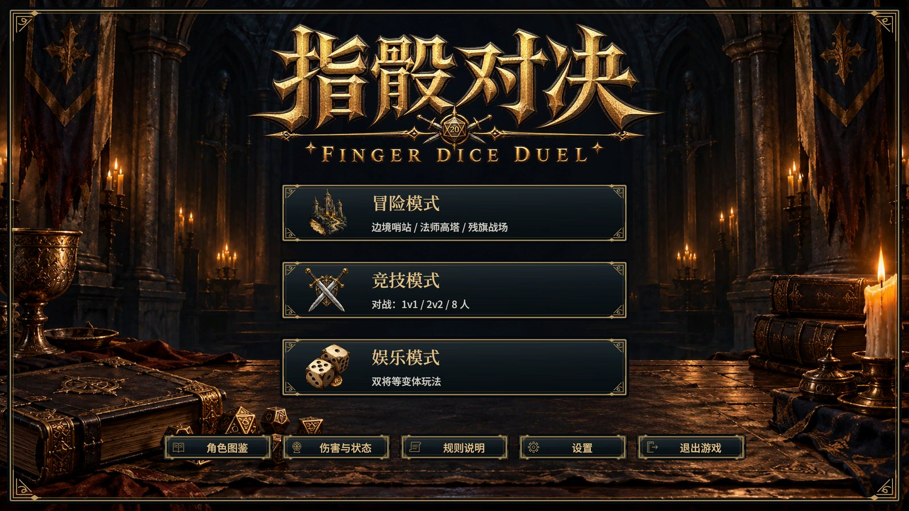
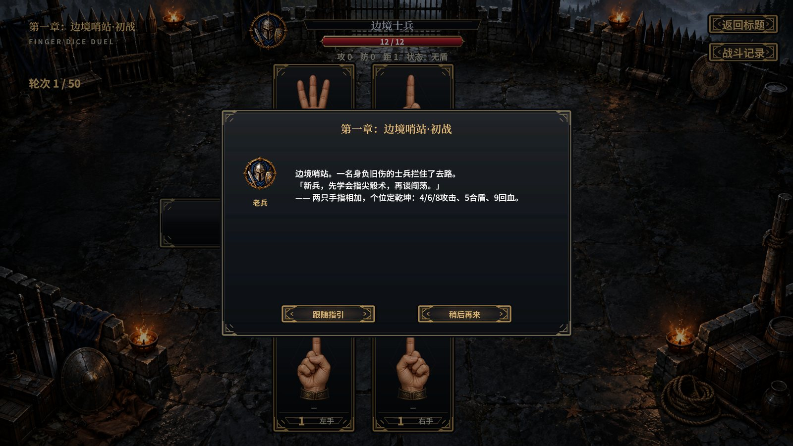
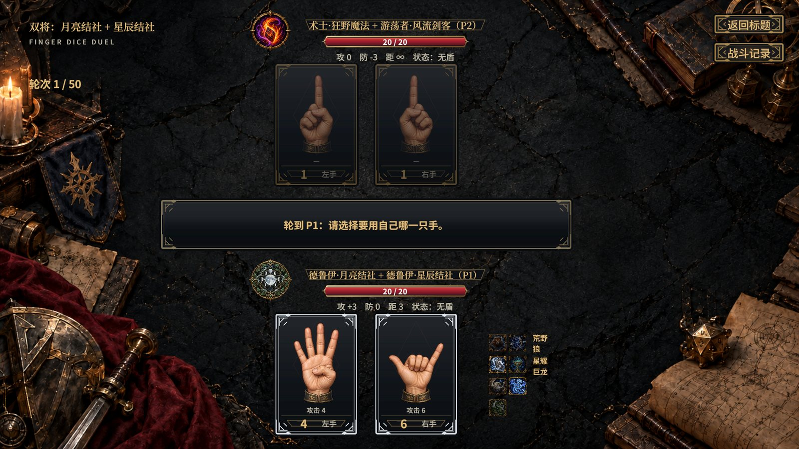
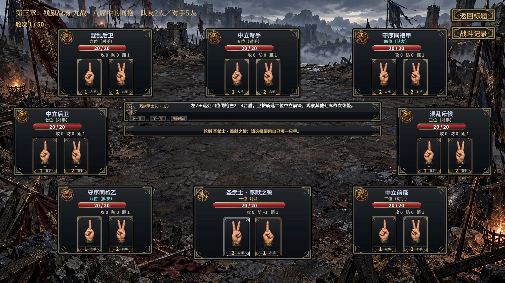

<div align="center">

</div>

# 指骰对决 · Finger Dice Duel

**两只手的数字，就是你的骰子。**

每人左右各一只手，手值 1–9。选自己一只手当运算手，再借走任意一名角色的一只加数手，个位定乾坤：4 / 6 / 8 打伤害，5 合成完整护盾，9 回复生命，满十归一、0 变 1。五十多个子职把这条算式改写成了各自的脾气——有人合盾时顺手砸人，有人把 9 变成刀，有人干脆掷骰子。

暗色奇幻风格的 2D 回合制对战游戏。团结引擎（Tuanjie）`2022.3.62t15` · C# · 内置渲染管线 · uGUI / TextMeshPro，界面全部在运行时构建，打开工程直接 Play。


<table>
<tr>
<td></td>
<td></td>
</tr>
<tr>
<td align="center"><sub>冒险模式第一章：老兵手把手教三步运算</sub></td>
<td align="center"><sub>双将对决：两名同阵营子职叠加，532 种组合</sub></td>
</tr>
</table>

## 一回合怎么玩

1. **点自己的一只手**——这只手做运算手。
2. **点任一其他角色的一只手**——借它的数字当加数。队友可以借，也可以是攻击目标。
3. **个位出结果**，再按提示选攻击目标、主动技能或防御技能。

| 结果 | 基础效果 |
|---|---|
| **4 / 6 / 8** | 发起基础伤害 4 / 6 / 8 的攻击 |
| **9** | 自己回复 9 点生命 |
| **5** | 这只手合成一面完整护盾 |
| **1 / 2 / 3 / 7** | 只改变手值，不产生基础效果 |

运算只改变运算手，加数手不变；效果只在算出的那一刻结算一次——手停在 9 不会每回合自动回血。完整流程、距离、护盾与攻防结算见 [模式与战斗](./Docs/modes-and-combat.md)。

## 三种入口

| 入口 | 适合谁 | 内容 |
|---|---|---|
| **冒险模式** | 第一次上手 | 边境哨站 / 万象回廊 / 法师高塔 / 残旗战场四章，各十战（含终战）。跟着老兵学会基础运算，再逐步解锁距离、元素反应、援护和八人协作 |
| **竞技模式** | 想直接开打 | 1v1、2v2、8 人阵营混战、8 人身份对局 |
| **娱乐模式** | 想玩花的 | 双将对决：两名同阵营子职的技能叠在一个人身上 |



<p align="center"><sub>8 人身份对局：座位成环，距离按环上最短路径计算</sub></p>

## 快速开始

```powershell
# 1. 用团结引擎 2022.3.62t15 打开仓库根目录
# 2. 直接 Play —— 入口自动启动，不需要配场景、不需要挂预制体
```

主界面 → 设置 → 背景音乐可开关配乐并自动保存。首次体验建议 **冒险模式 → 剧情冒险 → 第一章 → 初战**，老兵会带你完成三步点击、4/6/8 攻击、5 合盾、9 回血和满十归一。

跑逻辑测试（不需要打开引擎）：

```powershell
$env:DOTNET_TieredCompilation='0'
$env:COMPlus_TieredCompilation='0'

powershell -NoProfile -ExecutionPolicy Bypass -File Tools/HeadlessTests/run-tests.ps1       # 全部逻辑测试
powershell -NoProfile -ExecutionPolicy Bypass -File Tools/HeadlessTests/run-tests.ps1 -Define FDD_UNITY_TESTS   # Unity/NUnit 条件编译
powershell -NoProfile -ExecutionPolicy Bypass -File Tools/UiCompileCheck/check-ui.ps1       # 表现层编译检查
```

规则内核、角色与 AI 不依赖 Unity，可以脱离引擎在 .NET 下无头运行，当前功能回归共 1670 项。

## 现在有什么

| 项目 | 数量 |
|---|---|
| 职业 / 子职 | 12 / 58（战士 7、圣武士 6、牧师 6、野蛮人 4、游侠 2、游荡者 5、吟游诗人 2、法师 9、术士 4、邪术师 4、德鲁伊 4、武僧 5） |
| 对局模式 | 6（剧情、1v1、2v2、双将、8 人阵营、8 人身份） |
| 伤害类型 | 13 |
| 负面状态 | 25 |
| 角色状态 | 6（圣火 / 剑歌 / 战争祝福 / 醉拳 / 神佑医者 / 知识祝福） |
| 元素反应 | 11 条 |
| 双将组合 | 532 种无序组合 |
| 回归测试 | 1670 项通过、0 失败 |

## 现在的样子

说清楚比较好：

- **只有本地对 AI**，联网对战没做。
- 2026-11-06 完成本轮技能和 AI 更新后，57 个子职共采样 64,768 局。报告包含各模式角色胜率、八人阵营整体胜率，以及随机／偏好选角两组身份胜率。[完整胜率与分母](Tools/Statistics/2026-11-06-arcane/README.md)
- **剧情难度待校准。** 四章40关先教学，再确认进入实战；敌方恢复最佳状态，实战可失败并直接重试，具体难度仍待真人试玩。
- 仓库体积约 2.3 GB，大头是 `Art/` 下的原图与验收截图。

## 文档

| 文档 | 内容 |
|---|---|
| [模式与战斗](./Docs/modes-and-combat.md) | 一回合完整流程、距离与护盾、六种模式细则、13 类伤害、25 种负面状态、11 条元素反应 |
| [角色图鉴](./Docs/roster.md) | 58 名子职的数值与关键机制、阵营分类、全角色胜率 |
| [RULES](./RULES.md) | 权威规则、完整技能数值与特殊交互 |
| [CODELY](./CODELY.md) | 工程结构、实现细节、开发约定与技术债 |
| [开发与测试](./Docs/development.md) | 测试环境、AI 策略参考、美术制作与接入验收索引 |
| [图鉴写法](./CODE-STYLE.md) | 文案长度、关键交互与排版约定 |

`Art/Integration/` 下每个功能点都有一个验收目录，放着真实界面截图、校验说明和复核记录。

## 许可

[MIT](./LICENSE)。字体使用思源黑体（Noto Sans CJK SC）与思源宋体，遵循 SIL Open Font License 1.1，详见 [字体许可](./Assets/Resources/Fonts/README-字体许可.txt)。

四章关卡与剧情详见[冒险试炼](Docs/Adventure/four-chapter-v3/README.md)。初战使用无特殊技能的重甲战士（攻+2／防+2）；教学结束确认后进入实战，失败可重新指引或直接再次试炼。

德鲁伊现采用独立荒野体力与充能；孢子结社已加入，双德鲁伊初始充能相加、双武僧初始4气（上限6），羊为5点体力。详见[重构说明](Docs/druid-rework-2026-11-05.md)。
